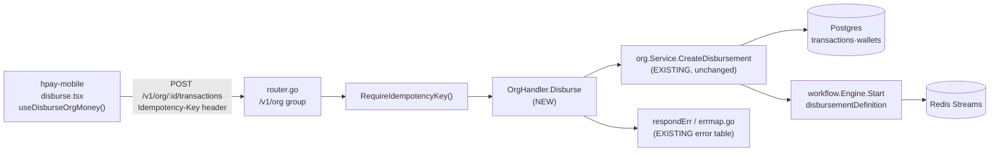
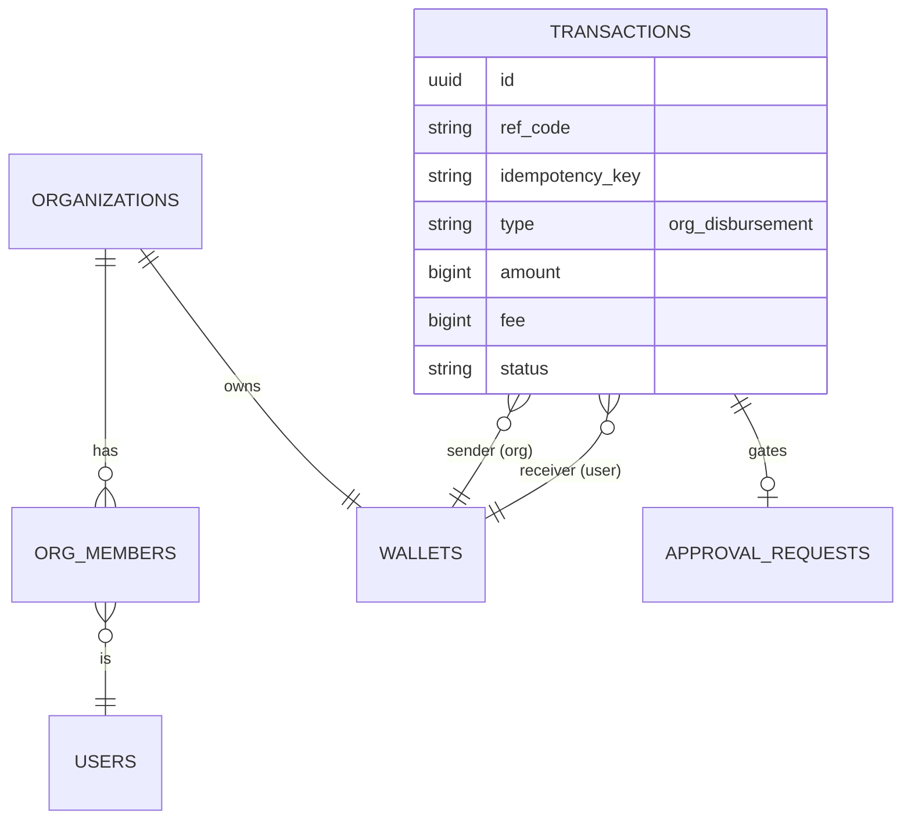

[← HPay Docs](../../../overview-v2.md) · src/backend/docs/plans/f6-org-disbursement-endpoint

# Solution Architecture — Org Disbursement HTTP Endpoint

> Pure wiring change: expose the already-implemented `org.Service.CreateDisbursement` over HTTP. No new domain logic, no schema change. Diagrams below show only the request path this feature adds.

## 1. Context



## 2. Main flow

```mermaid
sequenceDiagram
  participant M as Mobile (maker)
  participant R as router.go
  participant MW as RequireIdempotencyKey
  participant H as OrgHandler.Disburse (NEW)
  participant S as org.Service.CreateDisbursement
  participant DB as Postgres
  participant E as Workflow Engine

  M->>R: POST /v1/org/{id}/transactions {phone, amount, note}\nheader Idempotency-Key
  R->>MW: middleware chain
  alt header missing or >64 chars
    MW-->>M: 400 ERR_IDEMPOTENCY_KEY_REQUIRED
  else header present
    MW->>H: c.Set("idempotency_key", key) → Disburse(c)
    H->>H: bind JSON {phone, amount, note}
    alt bind fails
      H-->>M: 400 ERR_VALIDATION
    else bound ok
      H->>S: CreateDisbursement(ctx, actorID, orgID, phone, amount, note, idemKey)
      S->>DB: requireRole == maker
      alt not maker
        S-->>H: ErrForbiddenRole
        H-->>M: 403 ERR_FORBIDDEN_ROLE
      else maker
        S->>DB: policy/balance/receiver checks (fail-fast)
        alt any check fails
          S-->>H: domain error (ErrNoPolicy / ErrAmountInvalid / ...)
          H-->>M: mapped 4xx via respondErr
        else all pass
          S->>DB: BEGIN; InsertTransaction; COMMIT
          S->>E: engine.Start(disbursementDefinition)
          E-->>S: instance started (pauses later at WAIT_APPROVAL, async)
          S-->>H: DisbursementResult{ref_code,status,amount,fee,total,created_at}
          H-->>M: 201 DisbursementResult (JSON)
        end
      end
    end
  end
```

## 3. State

No new lifecycle. This endpoint only creates the transaction; the existing status machine (already documented in `docs/planning/master-plan.html §7`) applies unchanged: `created → pending_approval → processing → completed \| failed`, driven entirely inside `CreateDisbursement` + the workflow engine's `WAIT_APPROVAL` pause hook. The HTTP layer only ever observes the synchronous return value (`status` is whatever `InsertTransaction` set at the moment of response — typically `pending_approval` once the pause hook has run inline, or `created` if the caller races ahead of it).

## 4. Data model delta

None — no table or column changes. For reference, the existing shape this endpoint reads/writes:



## 5. Decisions & trade-offs

| Decision | Alternatives considered | Why |
| --- | --- | --- |
| Route path `POST /v1/org/{id}/transactions` | Route the mobile client's existing target vs. changing mobile to hit the unified `/v1/me/transactions/request` engine endpoint with a `service_code` | Mobile already calls this exact path and shape; the org group already scopes by `{id}` the same way members/policies do. Changing mobile would touch a second repo for zero benefit — the service method is org-specific (maker-role check, org wallet) and doesn't fit the generic engine's per-user model cleanly. |
| Response body = raw `org.DisbursementResult` struct (ref_code-keyed) | Wrap in a generic `{transaction_id, status}` envelope as the original ask suggested | Every other transaction-creation endpoint in this codebase (P2P transfer, topup, engine request) keys its response on `ref_code`, not a numeric/UUID transaction id — matching that idiom keeps the wire contract consistent. The mobile client's `OrgDisbursementResult` type was already written against this exact shape. |
| Idempotency key sourced from `c.GetString("idempotency_key")` (header, via middleware), request body has no idempotency field | Accept idempotency key in JSON body like `engineRequestReq.Idempotency` | Matches the `/v1/me/transactions/request` + topup + transfer convention exactly (header-only). Mobile's `useDisburseOrgMoney` already sends it as a header. |
| New handler method on existing `OrgHandler`, not a new handler type | Separate `OrgTransactionHandler` | `OrgHandler` already owns org-scoped mutations (Create, AddMember, CreatePolicy); one more org-scoped mutation keeps related code together, consistent with how the file is organized today. |

## 6. Invariants touched

| Invariant (docs index.html §8) | How this feature upholds it |
| --- | --- |
| Retries do not create duplicate transactions (idempotency) | Delegated entirely to `CreateDisbursement`'s existing unique-constraint + duplicate-detect path; the handler only forwards the header value untouched, plus `RequireIdempotencyKey()` rejects requests with no key before the service is ever called. |
| Every transaction has >= 2 ledger entries, total debits = total credits | Unaffected — ledger posting still happens inside the workflow engine's `MOVE_FUNDS` step, unchanged by this endpoint. |
| Maker-checker cho org_txn | `CreateDisbursement`'s `requireRole(..., OrgRoleMaker)` check runs unchanged; the new handler adds no bypass — it is a thin pass-through, and `errmap.go` already maps `ErrForbiddenRole`/`ErrNotMember` to 403. |
| Errors always use the Error schema with stable ERR_* code | Handler uses the existing `respondErr`/`respondValidation` helpers exclusively — no ad-hoc error JSON introduced. |

---
src/backend/docs/plans/f6-org-disbursement-endpoint · generated via gen-feature-plan
