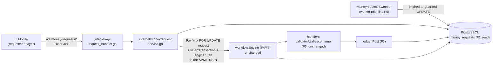
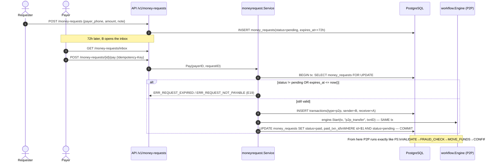
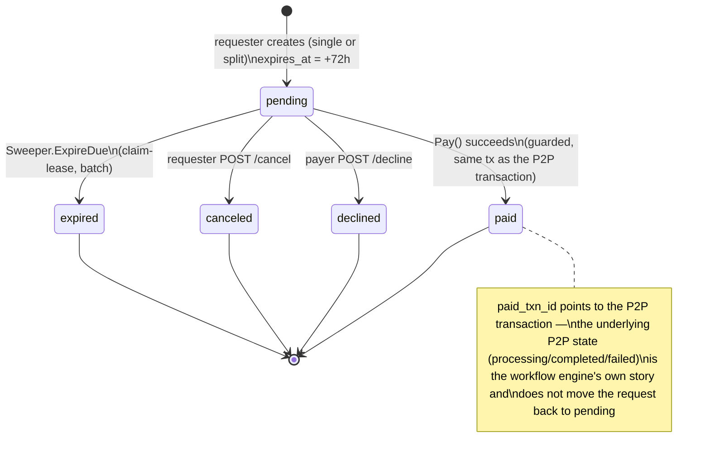
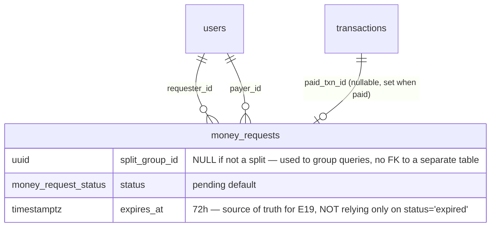

[← implementation-plan](implementation-plan.md) · f7-request-money

# F7 Request Money & Split Bill — Solution Architecture

## 1. Context — the parts of the system F7 touches

## 2. Main flow — request → pay (2 stages per doc 04 §2.1)

## 3. State — money_requests (defined in doc 04, re-confirmed)

## 4. Data model delta — no new tables

The schema is 100% from migration 000008 (F1). F7 needs no new migration.

## 5. Decisions & trade-offs

| Decision | Alternative | Why |
| --- | --- | --- |
| **E19 blocked by the transaction boundary**: `SELECT ... FOR UPDATE` + checking `expires_at > now()` directly in Go, without waiting for the sweeper to set status='expired' first | Rely only on `WHERE status='pending'`, with the sweeper as the sole source that sets expired | A deadline is a function of time, not a state that has to wait for a cron to label it — checking `expires_at` directly removes the entire race window between "logically expired" and "the sweeper has already marked it"; the sweeper only cleans up what is left when nobody presses pay |
| Pay() duplicates the P2P transaction creation logic instead of calling `transfer.Service.Transfer()` | Change `Transfer()` to accept an optional tx parameter | `Transfer()` manages its own tx (internal Begin/Commit) — to hold the `money_requests` FOR UPDATE lock all the way until the P2P transaction + `paid_txn_id` commit together, the cheapest way is to inline similar logic (there is precedent in `org.Service.CreateDisbursement`, which does exactly this with F5's pattern) rather than changing another module's public API just to serve 1 caller |
| Even Split Bill uses **largest-remainder** (pure BIGINT), not dividing and rounding each element independently | `total/n` then putting the difference onto the last element | Largest-remainder spreads the remainder more evenly (does not pile all the deviation on one person); it is still pure integers, and the sum matches the input absolutely — the rounding test confirms this directly |
| `paid_txn_id` is attached as soon as the P2P transaction IS CREATED (the transaction status may still be `processing`), not waiting for P2P `completed` | The request becomes `paid` only when P2P is really `completed` (needs an extra step to listen for the result) | Matches the original state diagram of doc 04 exactly (§2.1: "payer pays via the P2P engine — attach transaction_id"); avoids adding a new event-listening layer just to sync 2 state machines — if P2P later fails (rare), the UI can still read the true state via `paid_txn_id` → timeline API (exists since F5), without needing a second field to lie about the money's state |

## 6. Invariants touched (index.html §8)

| Invariant | How F7 upholds it |
| --- | --- |
| Every balance change goes through `ledger.Post` | Pay() does not touch the ledger — it only creates the transaction and hands it straight to `engine.Start`; money still flows through the F5 MOVE_FUNDS handler |
| Idempotency-Key on APIs that create transactions | `POST /money-requests/{id}/pay` requires the header and uses it as the `idempotency_key` of the underlying P2P transaction — a double-tap on pay does not create 2 transactions (E01 pattern intact) |
| State transitions always have a WHERE status guard | `FinalizeGuarded/DeclineGuarded/CancelGuarded` all use `WHERE status='pending'`; Pay() additionally adds `AND expires_at > now()` (E19) |
| Two-layer AuthZ | Pay/Decline only by the payer of that exact row; Cancel only by the requester; the predicate lives in SQL (`WHERE id=$1 AND payer_id=$2`), not only checked in the handler |

> **Interview talking point of this phase:** Request Money is not a new money flow — it proves that the workflow engine + ledger built in F3-F5 are general enough to be "borrowed" intact for a very different UX use case (asking for money instead of actively sending it), needing only a thin state layer in front. The real race track of E19 is the transaction boundary, not a boolean flag.
