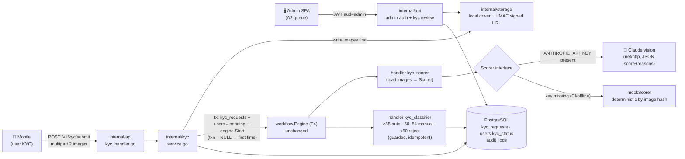
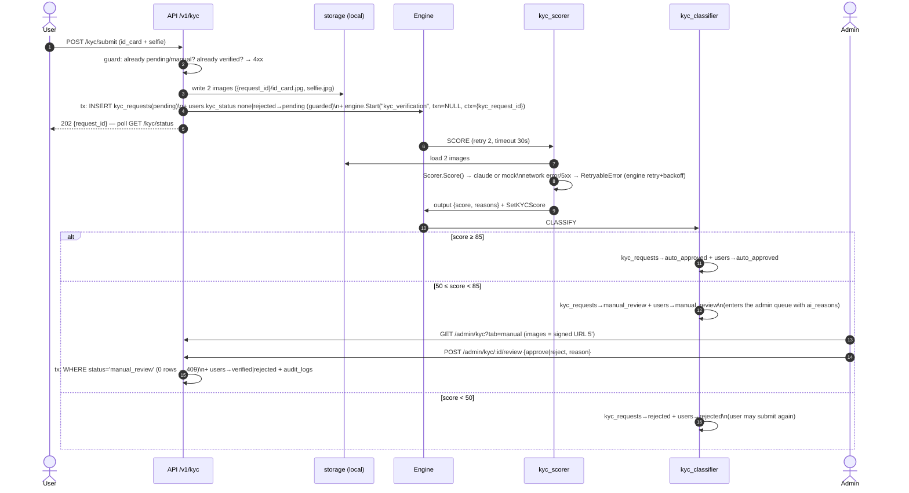
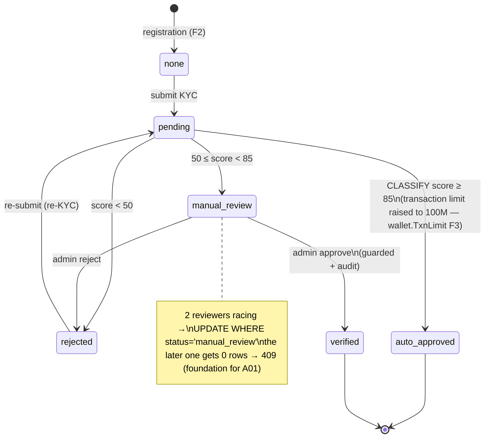
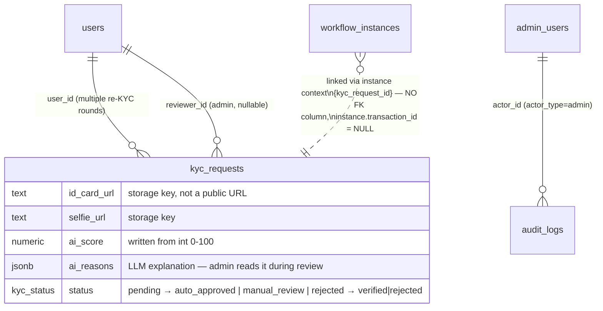

[← implementation-plan](implementation-plan.md) · f8-kyc

# F8 KYC + AI — Solution Architecture

## 1. Context — the parts of the system F8 touches

## 2. Main flow — submit → score → classify → (review)

## 3. State — users.kyc_status (enum exists since F1, only now runs the full cycle)

## 4. Data model delta — no new tables

Migration 000014 only seeds: definition `kyc_verification` v1 + 1 dev admin user. No ALTER.

## 5. Decisions & trade-offs

| Decision | Alternative | Why |
| --- | --- | --- |
| **2 steps SCORE → CLASSIFY** instead of 1 step doing both | 1 step calls the LLM and classifies right away | Separates the *non-deterministic + slow + retryable* part (the LLM call) from the *deterministic* part (thresholds): SCORE can be retried without re-running classification; CLASSIFY is purely idempotent thanks to the guarded UPDATE; the admin timeline (A3) clearly shows where it is stuck |
| Link instance ↔ kyc_request via **workflow context** (`{kyc_request_id}`), no new column | Add a column `kyc_requests.instance_id` or `workflow_instances.subject_id` | The JSONB context exists for exactly this (docs 00 §3.3 "data passed between steps"); adding a generic subject column to workflow_instances is a large schema change not yet needed — if F9+ needs frequent reverse lookup, propose a docs fix first |
| Scorer chosen by **presence of ANTHROPIC_API_KEY**, mock deterministic by image hash | A separate config flag KYC_SCORER=claude\|mock | Matches the design in docs 00 §8.2 ("mock fallback when the key is missing"); a hash-based mock makes demos repeatable (same image → same verdict) instead of purely random |
| Score is `int` 0–100 throughout Go, written into NUMERIC(5,2) | float64 matching NUMERIC | There is no reason to need decimals; keeping the codebase 100% float-free makes the review/interview story absolutely clean |
| HMAC signed URL (key+exp, secret=JWT_SECRET) for images, a separate route without JWT | Admin endpoint streaming images behind RequireAdmin | An SPA rendering `` cannot attach an Authorization header — a signed URL is self-authenticating, matching doc 01 §3.4 "URL signed with a 5-minute lifetime"; the short TTL limits leakage |
| **Minimal admin auth in F8** (login + middleware, access-only) | Wait for a dedicated admin phase | Master plan F8 explicitly says "admin review API" — without a login path that API is unusable; the F2 JWT issuer already supports audience so the cost is near zero; refresh/detailed RBAC wait until the A-phases need them |
| Admin review uses a guarded UPDATE (0 rows → 409), not FOR UPDATE | SELECT FOR UPDATE like the F6 approval | Review is a single-statement transition, with no multi-step evaluation like approval — the WHERE guard is atomic enough and takes fewer locks; it returns exactly the 409 semantics that A01 (admin repo) needs |

## 6. Invariants touched (index.html §8)

| Invariant | How F8 upholds it |
| --- | --- |
| State transitions always have a WHERE status guard | `SetUserKycStatusGuarded` follows a fixed transition map; `ClassifyKYCGuarded WHERE status='pending'`; `ReviewKYCGuarded WHERE status='manual_review'` — a replayed CLASSIFY (at-least-once) becomes a no-op |
| Events are emitted only via the outbox | The KYC workflow follows the F4 path unchanged: engine.Start writes the outbox in the submit tx; handler results go through recordAndEmit — no manual XADD |
| The LLM never decides on its own to block/unblock money | The LLM only returns score+reasons; the decision is the deterministic thresholds in CLASSIFY + a human in manual_review (per the principle in index.html §9) |
| No logging of secrets/PII | No images/base64/API key are logged; the scorer logs only score + request_id; the admin password appears in no log |
| Two-layer AuthZ | Queue/review sit behind RequireAdmin (aud=admin — a user token cannot be used even if leaked, doc 01 §3.1); review writes audit_logs with actor+reason; images are reachable only via a 5' signed URL |
| Biometric/KYC does not change the money rules | KYC only raises `wallet.TxnLimit` via kyc_status — no shortcut writes the ledger |

> **Interview talking point of this phase:** the same workflow engine now runs 3 kinds of flow — automatic (P2P), a human gate mid-way (org approval), and **no-transaction** (KYC) — proving that F4's nullable "transaction_id" is a deliberate design rather than technical debt. And AI is placed in the right spot: the LLM scores, deterministic thresholds + humans decide.
