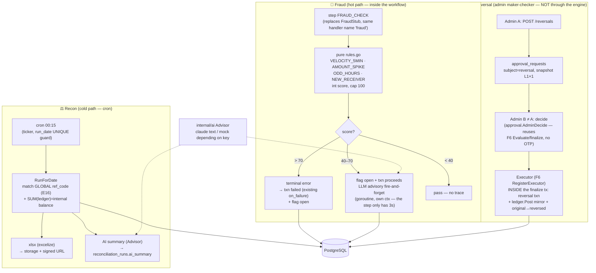
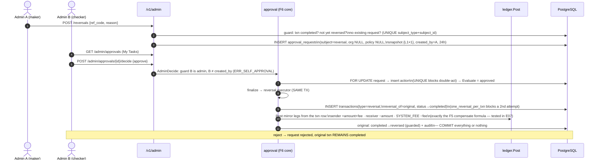
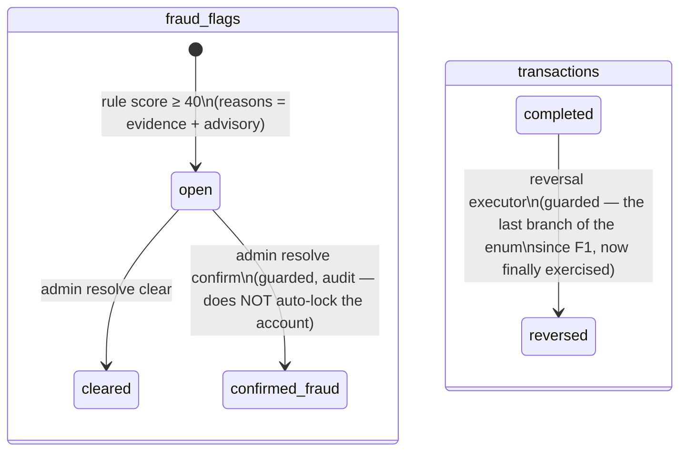
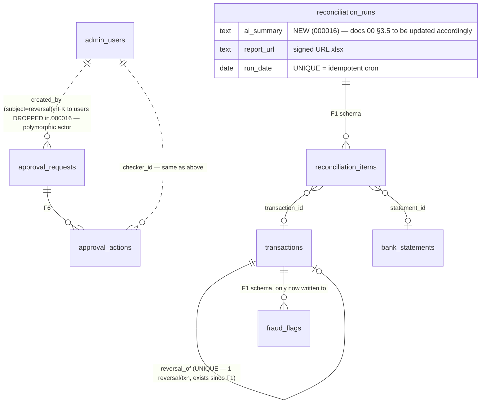

[← implementation-plan](implementation-plan.md) · f9-fraud-recon-reversal

# F9 Fraud + Recon + Reversal — Solution Architecture

## 1. Context — 3 areas, where they touch the system

## 2. Main flow — reversal end-to-end (the area that touches money, drawn in most detail)

## 3. State — fraud_flags + transactions, finally opening the reversed branch

## 4. Data model delta

## 5. Decisions & trade-offs

| Decision | Alternative | Why |
| --- | --- | --- |
| **LLM advisory fire-and-forget** (goroutine + own context, update flag reasons afterwards) | Call synchronously in the handler | FRAUD_CHECK has timeout_ms=3000 in the running definition — an LLM taking 5–15s would blow the timeout and trigger a pointless retry; the block/flag decision is already made BEFORE the LLM is called, so async does not change semantics (the LLM decides nothing — matches principle §9) |
| Block at **>70** with a pure rule, terminal error via the existing on_failure | Add a new on_failure=flag_review to the engine | The docs' gray zone is 40–70 → above 70 is the zone where the rule is confident; on_failure=fail in the current definition gives the right behavior (txn fails, no compensation needed because money has not moved — FRAUD_CHECK comes before MOVE_FUNDS); the engine is unchanged |
| Recon matches **global ref_code**, no date filter; date mismatch is recorded as detail cutoff_shift | Match within the day + widen the window ±15' | This is literally the E16 wording in docs 01 ("match by ref_code, not only by date"); any time window is a heuristic that can be wrong — whereas ref_code is an absolute identifier |
| Reversal **does not go through the workflow engine**, executor in the finalize tx | A 2-step reversal_flow definition | Doc 04 §1 states verbatim "passive reversing entry, does not go through the engine"; the whole effect (new txn + ledger + original reversed + audit) is ONE ACID transaction — the engine adds nothing except latency |
| Mirror legs from the **txn row** (amount, fee) | Read the original ledger_entries and invert line by line | The same source of truth that F5 Wallet.legs(compensate) uses — already proven balanced via E07; the txn row is immutable after completed so it is safe |
| approval_requests.created_by / actions.checker_id **drop the FK, keep NOT NULL** | 2 separate columns user_id/admin_id + CHECK | Least invasive to the running F6 code (the org path stays entirely unchanged); integrity by subject_type is enforced in the service (org path checks org_members, admin path checks admin_users) — exactly where that logic already lives |
| Fraud score/points are **int**, evidence is text with figures | float confidence | Keeps the repo-wide no-float discipline; the rule thresholds are integer constants readable in 1 line of code |

## 6. Invariants touched (index.html §8)

| Invariant | F9 upholds it by |
| --- | --- |
| Ledger is INSERT-only; a refund = a new reversing transaction with reversal_of | Reversal = new txn + new entries via `ledger.Post`; no entry is UPDATEd/DELETEd; `one_reversal_per_txn` + the completed→reversed guard block a double reversal |
| After completed the state is not edited in place | completed→reversed is the ONLY transition allowed from completed (state diagram index §7), guarded WHERE status='completed' |
| The LLM never decides on its own to block money | Block = int threshold rule; the LLM only writes text into reasons, runs after the decision, LLM errors are silently swallowed |
| wallets.balance = SUM(ledger) | Internal recon on each run checks exactly this equality on every wallet; a mismatch → item + ai_summary naming it |
| Maker ≠ Checker also in internal operations (doc 04 §2.3) | AdminDecide blocks created_by == decider (ERR_SELF_APPROVAL) + UNIQUE(request_id, checker_id) |
| State transition guard WHERE status | ResolveFraudFlagGuarded WHERE 'open'; MarkTransactionReversed WHERE 'completed'; run_date UNIQUE makes recon idempotent |

> **Interview point of this phase:** the hot path and the cold path are cleanly separated — the fraud rule runs inside the step's 3ms budget, the expensive LLM is pushed out of band; recon proves the accounting equation every night instead of trusting the code; and reversal shows that the F6 approval framework really is shared infrastructure: adding a new subject = 1 executor + 0 lines changed in the core.
