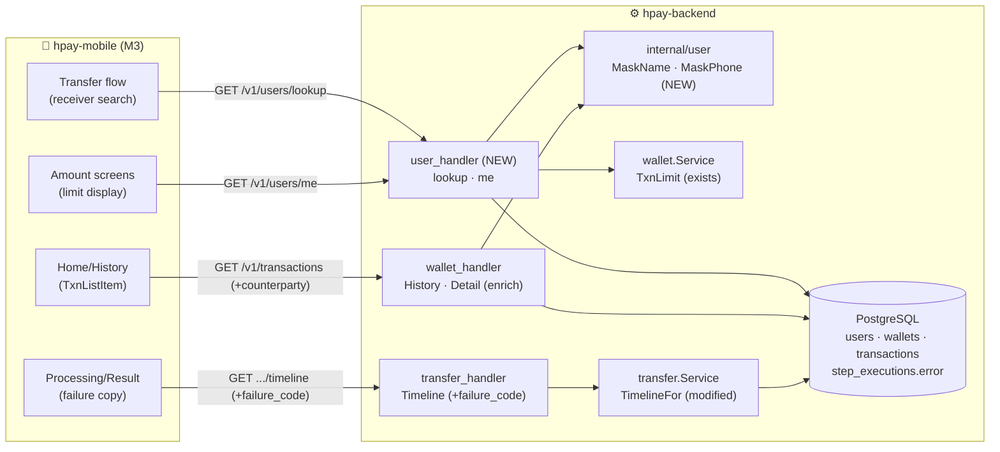
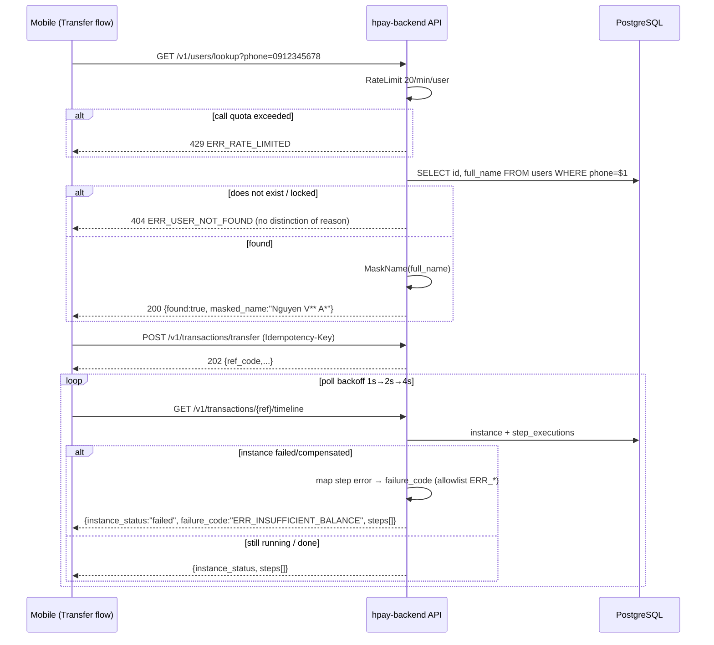
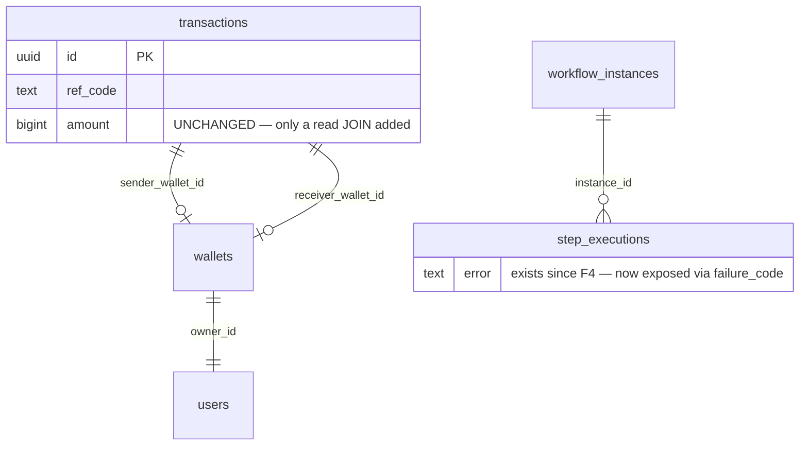

# 🏗 Solution Architecture — M3 API Support `backend`

## 1. Context — the parts of the system touched

## 2. Main flow — lookup + transfer with enriched data

## 3. State

No new lifecycle — only reads existing state. (`failure_code` is derive-only from a failed instance, no status is added.)

## 4. Data model delta

**No new tables/columns.** A2 = a two-way JOIN `transactions → wallets → users` to get the opposite owner; A4 = reads `step_executions.error` of the last failed step.

## 5. Decisions & trade-offs

| Decision | Alternative | Why |
| --- | --- | --- |
| The `/v1/users/me` endpoint returns `txn_limit` | (a) FE hardcoded map (old plan) · (b) stuff the limit into /v1/wallets | (a) already diverged from reality from the plan stage — the server is the single source of truth; (b) the limit belongs to the user (KYC tier), not to the wallet. `/me` is also used to refresh `kyc_status` after KYC is approved (M2 lacks this place) |
| Enrich history with a JOIN, new DTO in the service | FE calls lookup N times by wallet_id | N+1 requests + would need to open an endpoint that resolves wallet→user (exposing the wallet-person link more); a JOIN is 1 query, masked right on the server |
| `failure_code` mapped via an allowlist in `errmap.go` | Return `step_executions.error` directly | Internal errors may contain infrastructure details (SQL, saga) — the public view may only see stable ERR_* codes; errors outside the allowlist → `ERR_TRANSFER_FAILED` |
| Lookup rate-limit 20/min/user + uniform 404 | No limit / return found:false 200 | Prevents phone-number contact enumeration — same "do not reveal existence" principle as login/txn detail |
| Masking on the server, fixed format locked in tests | FE masks by itself | FE masking would mean FE has to receive raw data — violating the data-minimization principle; the format is locked by tests so the 2 FEs (mobile/admin) display consistently |

## 6. Invariants touched (index.html §8)

| Invariant | This phase upholds it by |
| --- | --- |
| Money is BIGINT minor units | `txn_limit` returns int64; no other new money field |
| Ledger is INSERT-only / every balance change goes through the engine | Read-only phase — does not write ledger/transactions |
| Do not reveal the existence of other people's resources | Uniform lookup 404 + rate-limit; counterparty always masked; Detail keeps its ownership check |
| API change → openapi.yaml in the same commit | T6 in the same PR; mobile regenerates types |

---

hpay-backend · docs/plans/m3-api-support · 18/07/2026
