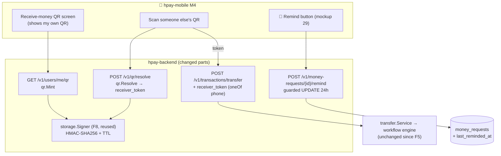
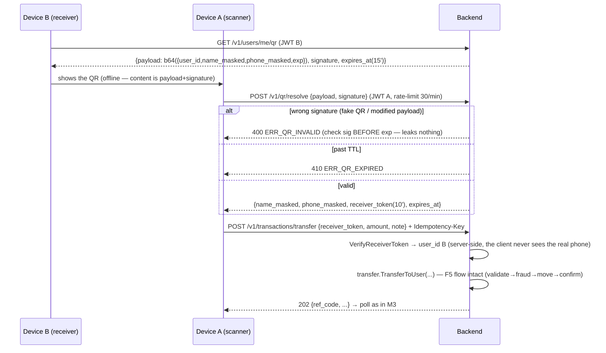
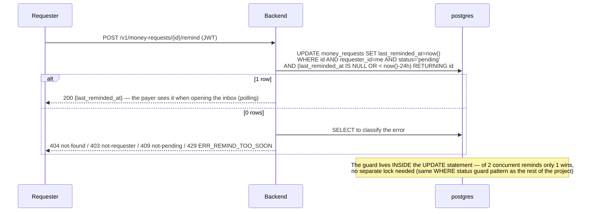
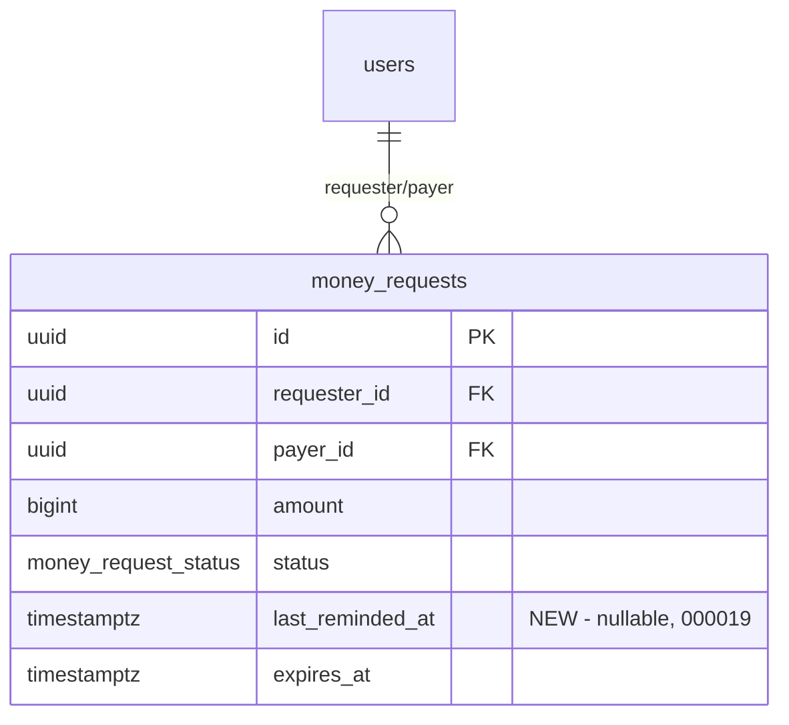

[← implementation-plan](implementation-plan.md) · m4-api-support

# M4 API Support — Solution Architecture

## 1. Context

## 2. Main flow — QR mint → resolve → transfer

## 3. Main flow — remind + 24h guard

There is no new state machine (money_request_status is unchanged; `last_reminded_at` is metadata, not a state).

## 4. Data model delta

The QR/token are fully stateless (HMAC) — no new table, tokens are not stored.

## 5. Decisions & trade-offs

| Decision | Alternative | Why |
| --- | --- | --- |
| QR + receiver_token stateless via HMAC (reuse storage.Signer, add generic Sign/VerifyMsg functions) | A qr_tokens table in the DB; or JWT | The Signer already exists, is tested, and verify-sig-before-exp is to standard; stateless = no garbage cleanup, no extra table; JWT is heavy and gets mixed up with auth tokens |
| Transfer accepts `receiver_token` as oneOf `receiver_phone`, refactor `TransferToUser(receiverID)` | A separate transfer endpoint for QR | 1 endpoint, 1 money flow — identical idempotency, fee, workflow; old clients do not break; the token purpose is later reusable for pay-by-counterparty (M3 backlog) |
| The QR payload contains user_id + masked data, NOT the real phone | Contain only an opaque token | Doc 02 §5 requires the payload to carry user_id + masked phone so the confirm screen can display without a round trip; money can still only move via a signed token |
| Remind = column `last_reminded_at` + guarded UPDATE, no notifications infra | A notifications table + push | Doc 02 §6: polling is enough for v1; the payer sees the reminder via the existing inbox; notifications infra is a separate backlog, rushing it would be half-baked |
| Resolve requires JWT + RateLimitUser 30/min | Public without auth | Prevents probing/brute-force of the payload; the scanner is surely a logged-in user (they want to transfer money after all) |

## 6. Invariants touched (index.html §8)

| Invariant | Upheld by |
| --- | --- |
| Every balance change goes through ledger.Post / the engine | Transfer-by-token flows into the same transfer.Service → F5 workflow; QR/remind do not touch money |
| Money-path idempotency | Transfer-by-token still goes through RequireIdempotencyKey + UNIQUE — unchanged |
| PII masking server-side | Resolve/QR only return MaskName/MaskPhone (m3); the real phone never leaves the server in the QR flow |
| State transition guarded | Remind does not change status; the 24h guard is atomic inside the UPDATE |
| Error contract ERR_* | 3 new codes registered in errmap + openapi in the same commit |

---

m4-api-support · solution architecture v1 · 18/07/2026
