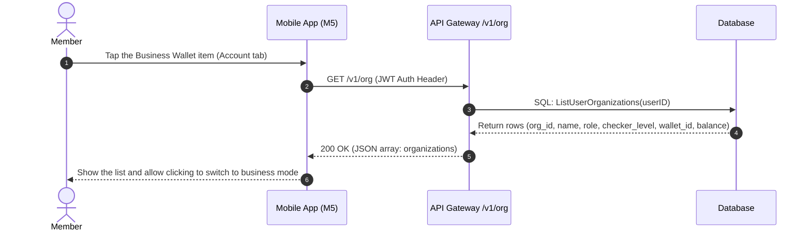

[← implementation-plan](implementation-plan.md) · m5-api-support

# M5 API Support — Solution Architecture

## 1. Context

```mermaid
flowchart TD
  subgraph MOB["📱 hpay-mobile M5"]
    SW["Business wallet switcher"]
    HOME["Home screen (Business mode)"]
  end
  subgraph BE["hpay-backend (M5 Support)"]
    LIST["GET /v1/org\nListUserOrganizations"]
    DB[("organizations ⋈ org_members ⋈ wallets")]
  end
  SW -->|Request the business list| LIST
  LIST -->|SQL query + JOIN| DB
  LIST -->>|Return businesses + roles + wallet balances| SW
  SW -->|Switch| HOME
```

## 2. Sequence Diagram



## 3. Database Query design

The `ListUserOrganizations` method joins 3 tables to fetch all the metadata the client needs in a single call:

```text
-- name: ListUserOrganizations :many
SELECT 
    o.id AS org_id, 
    o.name, 
    o.status, 
    m.role, 
    COALESCE(m.checker_level, 0)::smallint AS checker_level, 
    w.id AS wallet_id, 
    w.balance
FROM org_members m
JOIN organizations o ON o.id = m.org_id
LEFT JOIN wallets w ON w.owner_type = 'organization' AND w.owner_id = o.id
WHERE m.user_id = $1 AND o.status = 'active';
```

## 4. Architectural Decisions

| Design choice | Alternative | Advantage of the chosen option |
| --- | --- | --- |
| Return the business wallet balance (`balance`) directly in the list | Return only the list of business IDs, the client then calls `GET /wallets/:id` itself | Minimizes the number of API requests when switching to business mode; the client can draw the business Home screen immediately without waiting for the wallet API to load. |
| Filter out inactive organizations (status <> 'active') at the SQL layer | Filter in Go code or React Native code | Protects data at the DB layer; the client never sees businesses that have been locked/suspended. |
