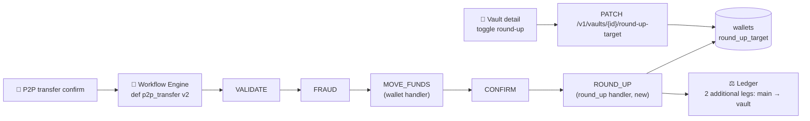
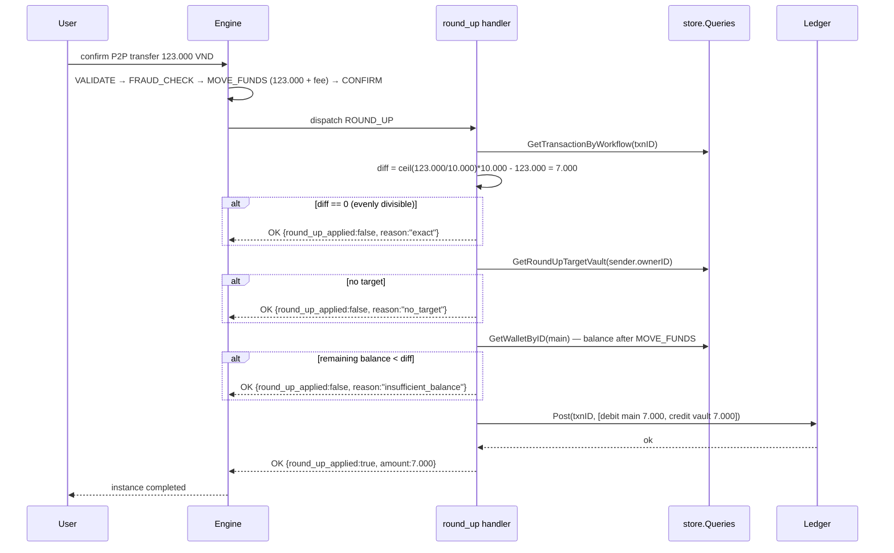
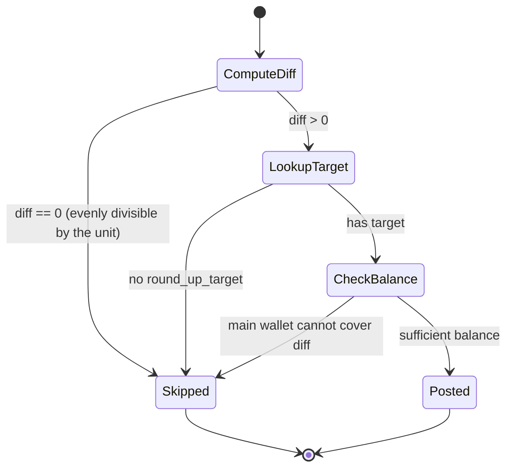
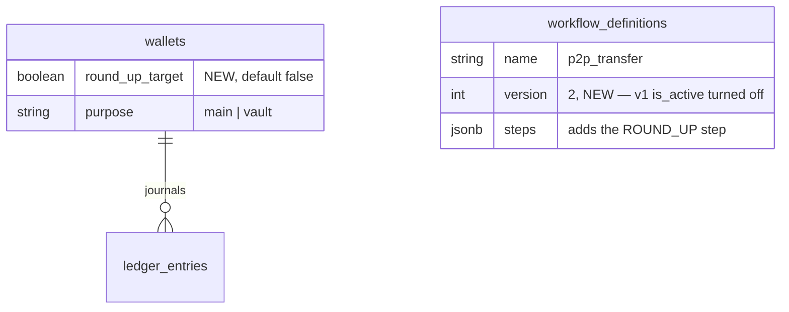

[← HPay Docs](../../../overview-v2.md) · repo `hpay-backend` · plan · solution architecture

# Solution Architecture — Round-up Vault Step

> Companion to [implementation-plan.md](./implementation-plan.md). Guiding principle: round-up is a **step appended to the end of a workflow definition**, not a separate feature — in keeping with the "showcase a configurable engine" spirit of doc 04 §2.2.

## 1. Context

## 2. Main flow — P2P transaction with round-up

**Design invariant:** every "not applied" branch returns `OK` and never returns a terminal error for a business reason — round-up is best-effort and must never corrupt the `completed` state of the main transaction that already finished at the earlier CONFIRM step.

## 3. State — decision branches of the round_up handler

## 4. Data model delta

Constraint: **partial unique index** `(owner_type, owner_id, currency) WHERE round_up_target AND purpose='vault'` — guarantees that at any moment each user has at most 1 round-up vault; changing the target is a single DB transaction (unset the old one, set the new one) so the index is never violated midway.

## 5. Decisions & trade-offs

| Decision | Alternative | Why |
| --- | --- | --- |
| Add version 2 of `p2p_transfer`, do not edit v1 in place | UPDATE the steps of v1 | In-flight instances reference a fixed `definition_id`; editing the JSONB in place would make `ParseSteps` read a different definition than at `Start` — violating the workflow invariant (the incrementing-version convention already exists in migration 000003) |
| Round-up never fails the main transaction | Treat round-up as a mandatory step like MOVE_FUNDS | Doc 04 calls this stretch/optional; making it mandatory would turn a side feature into a single point of failure for all of P2P |
| The rounding unit is a system constant (env, default 10,000) | Per-user configuration | Keeps the scope small, true to "stretch"; adding a UI to choose the unit is a different feature, not in doc 04 |
| The target vault is identified by the `round_up_target` column on `wallets` itself | A separate `user_preferences` configuration table | A vault is already a `wallets` row; putting the flag on it avoids a table that exists only to hold a 1-to-1 relationship |
| Do not touch the unwired `ActionPipeline` gap | Take the opportunity to wire `action_pipeline` into the definition | Outside the scope of round-up; wiring it in the wrong place could unintentionally trigger "Directional Integration" actions (calls to the real bank gateway) — needs its own plan for careful review |

## 6. Invariants touched

| Invariant (index §8) | How it is preserved |
| --- | --- |
| Money is `BIGINT`, no float | `diff` is computed with integer division/multiplication on `int64`, never passing through a float at any step |
| Each transaction has ≥ 2 ledger entries, Debit = Credit | The round-up legs are their own balanced debit/credit pair, added to the same `transaction_id` — they do not break the leg pair of MOVE_FUNDS that was posted earlier (following the fee-leg precedent) |
| `wallets.balance = SUM(ledger_entries)` | `ledger.Post` is the only posting path, reusing the existing function as is; there is no shortcut that writes `balance` directly |
| Ledger is append-only | No new UPDATE/DELETE; trigger 000007 still applies |
| Retry does not create a duplicate transaction | The engine's existing unique key `step_executions(instance_id, step_name, attempt)` protects round_up exactly like every other step |
| Customer balance is never negative | The main wallet balance is checked before posting; if insufficient it skips instead of letting `ledger.Post` return `ErrInsufficientBalance` midway |

---
HPay · plan generated by skill `gen-feature-plan` · repo hpay-backend · 2026-07-24
