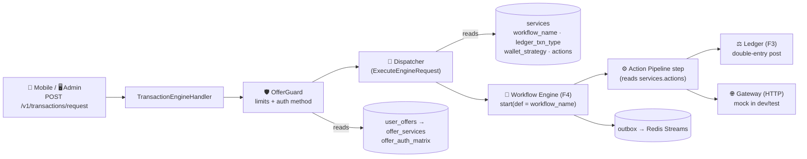
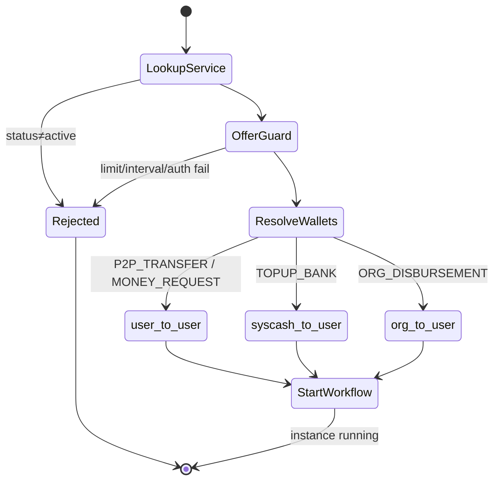
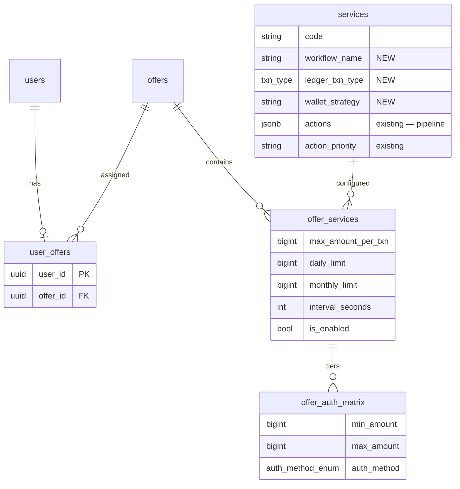

[← HPay Docs](../../../overview-v2.md) · repo `hpay-backend` · plan · solution architecture

# Solution Architecture — Dynamic Service Engine Dispatcher

> Companion to [implementation-plan.md](./implementation-plan.md). All diagrams are mermaid. Only the parts of the system this feature touches are drawn.

## 1. Context

The 3 engine APIs stay unchanged; the new insertion points are the **Dispatcher** (reads `services`) and **OfferGuard** (reads `user_offers/offer_services/offer_auth_matrix`) placed in front of the Workflow Engine.



## 2. Main flow

The request→confirm flow for any `service_code`, including the OfferGuard failure branch and the action pipeline branch.

```mermaid
sequenceDiagram
  participant C as Client
  participant H as EngineHandler
  participant OG as OfferGuard
  participant DP as Dispatcher
  participant DB as Postgres
  participant WE as WorkflowEngine
  participant AP as ActionPipeline
  participant GW as Gateway

  C->>H: request{service_code, amount, ...}
  H->>DP: ExecuteEngineRequest(input)
  DP->>DB: GetServiceByCode(code)
  alt service.status != active
    DP-->>C: ERR_SERVICE_DISABLED
  end
  DP->>OG: Check(user, service, amount)
  OG->>DB: user_offers → offer_services (limits, volume)
  alt limit exceeded / interval / not in offer
    OG-->>C: ERR_LIMIT_* / ERR_TOO_FREQUENT / ERR_SERVICE_NOT_IN_OFFER
  end
  OG->>DB: offer_auth_matrix(amount) → auth_method
  OG-->>DP: auth_method
  DP->>DB: resolveWallets(wallet_strategy)
  DP->>DB: BEGIN; InsertTransaction(ledger_txn_type); engine.Start(workflow_name); COMMIT
  DP-->>C: {transaction_id, ref_code, auth_required=auth_method}
  C->>H: confirm{transaction_id, pin/otp/2fa}
  H->>WE: verify auth_method matches → resume
  WE->>AP: run steps (before_gl actions → GL post → after_gl actions)
  AP->>GW: HTTP gateway call (Directional Integration)
  AP->>DB: ledger double-entry post
  WE->>C: (poll) status=completed
```

## 3. State — service dispatch resolution

The transaction state does not change (it reuses F4's `wf_status`); what is new is the step that resolves service → execution strategy.



## 4. Data model delta

Adds `user_offers` + 3 dispatch columns on `services`. The offer/auth tables already exist (000004).



## 5. Decisions & trade-offs

| Decision | Alternative | Why |
| --- | --- | --- |
| Reuse the `services.actions` JSONB for the Action Pipeline | Create a separate `service_action_steps` table | The schema already has `actions` and the admin 5-tab UI already writes into it; adding a table = drifting from docs-first and having to keep 2 sources in sync |
| Dispatch metadata as columns on `services` | A separate `service_workflow` mapping table | It is a 1-to-1 relationship with the service, columns are simpler; reading 1 row is enough |
| OfferGuard fails closed | Fail-open (let through when the offer is missing) | Fintech principle: if the limit is unclear, reject — never let money move |
| Feature flag `ENGINE_DYNAMIC_DISPATCH` | Straight cut-over | `ExecuteEngineRequest` is a hub symbol; needs gradual enablement + fast rollback |
| HTTP gateway has an interface + mock | Call the partner API directly | testcontainers-based tests need determinism; matches the doc 01 §8 trade-off (storage/EventBus interface) |

## 6. Invariants touched

| Invariant (index.html §8) | How the feature upholds it |
| --- | --- |
| The ledger always balances, money is BIGINT minor units | Every wallet_strategy still posts double-entry via `ledger.Post`; there is no path that writes balance directly |
| Every actor goes through the proper engine (no "back door") | Topup/disbursement now also go through `engine.Start` + outbox like P2P (lesson from the reference wallet §2) |
| Idempotency on the POST that creates a transaction | Keeps the `Idempotency-Key` UNIQUE + response snapshot unchanged (E01) |
| KYC tier limit + Offer limit | OfferGuard adds the offer_services layer on top of the existing KYC tier check (E13) |
| At-least-once + idempotent handler | The Action Pipeline step checks `step_executions` before any side effect (E04/E06); the gateway call carries an idempotency ref |

---
HPay · plan generated by skill `gen-feature-plan` · repo hpay-backend · 2026-07-22
