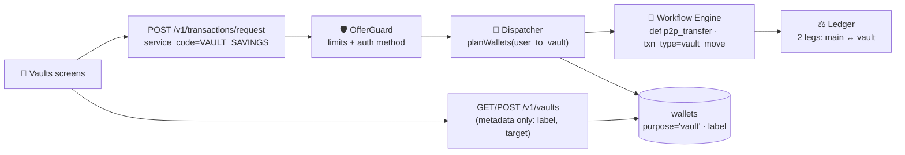
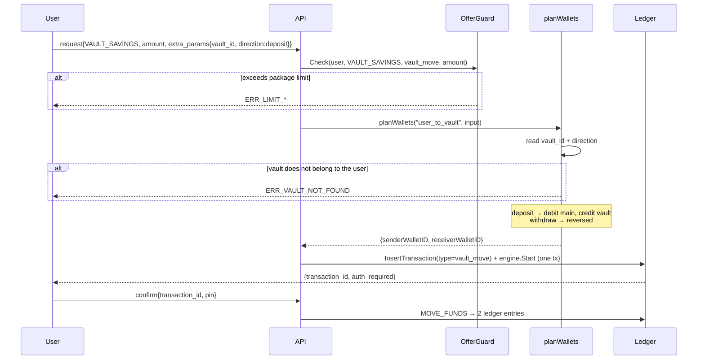
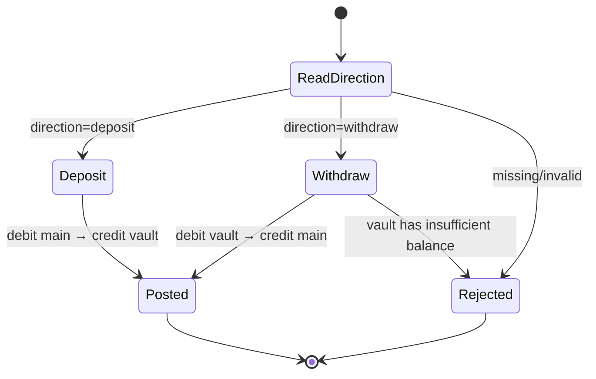
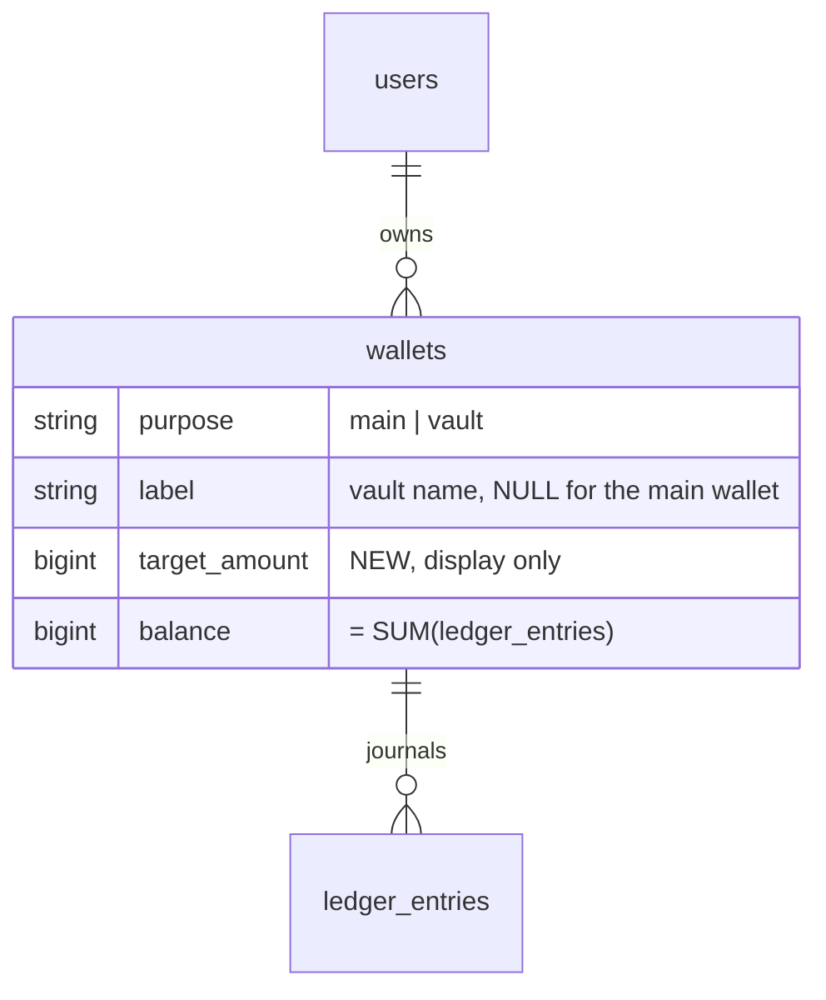

[← HPay Docs](../../../overview-v2.md) · repo `hpay-backend` · plan · solution architecture

# Solution Architecture — Vaults through the Engine

> Companion to [implementation-plan.md](./implementation-plan.md). Guiding principle: a vault has **no** dedicated money path — it is just one more `service_code` in the existing engine.

## 1. Context

## 2. Main flow — deposit into a vault

## 3. State — direction of movement

## 4. Data model delta

No new table — a vault **is** a wallet. Only the constraint is relaxed and a target column is added.

Constraint: `UNIQUE (owner_type, owner_id, currency, purpose, label)` for vaults, together with a **partial unique index** `(owner_type, owner_id, currency) WHERE purpose='main'` — because the main wallet's `label` is `NULL` and in Postgres `NULL ≠ NULL`; without this index a user could create multiple main wallets.

## 5. Decisions & trade-offs

| Decision | Alternative | Why |
| --- | --- | --- |
| A vault is `wallets.purpose='vault'` | A separate `vaults` table + a separate balance | Keeps the invariant "every balance = SUM(ledger)"; a separate table would create money that sits outside the ledger |
| Deposit/withdraw via `/transactions/request` | An endpoint `/vaults/:id/deposit` | Doc 06 already pruned every stray money path back into the engine; adding a dedicated money endpoint goes against that and bypasses OfferGuard |
| Direction goes in `extra_params.direction` | Two separate `service_code`s (VAULT_IN/VAULT_OUT) | Same product, same limits and auth matrix; splitting the service code would require duplicating the Offer configuration |
| Vault ownership is checked in SQL | Check in the handler | Doc 01 §3.2 layer 2: every user-data query must carry an owner condition, the handler is not trusted |
| Round-up comes later | Do it now | Doc 04 classes it as stretch; it is a step in the workflow definition, so adding it later does not break the structure |

## 6. Invariants touched

| Invariant (index §8) | How it is preserved |
| --- | --- |
| `wallets.balance = SUM(ledger_entries)` | A vault is a real wallet, every change goes through `ledger.Post`; internal recon scans vaults too |
| Each transaction has ≥ 2 ledger entries, Debit = Credit | `vault_move` is always a debit/credit pair between 2 wallets of the same user |
| Customer balance is never negative | A vault is a wallet with `owner_type='user'`, so it still sits under `CHECK (balance >= 0)`; withdrawing more than the balance is blocked |
| Idempotency on the POST that creates a transaction | Shares the `Idempotency-Key` of `/transactions/request` |
| Ledger is append-only | No UPDATE/DELETE at all; trigger 000007 still applies |

---
HPay · plan generated by skill `gen-feature-plan` · repo hpay-backend · 2026-07-23
