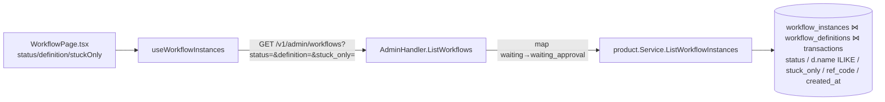
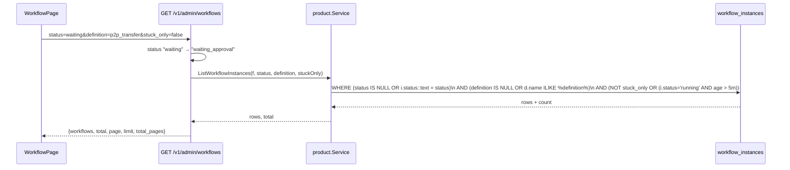
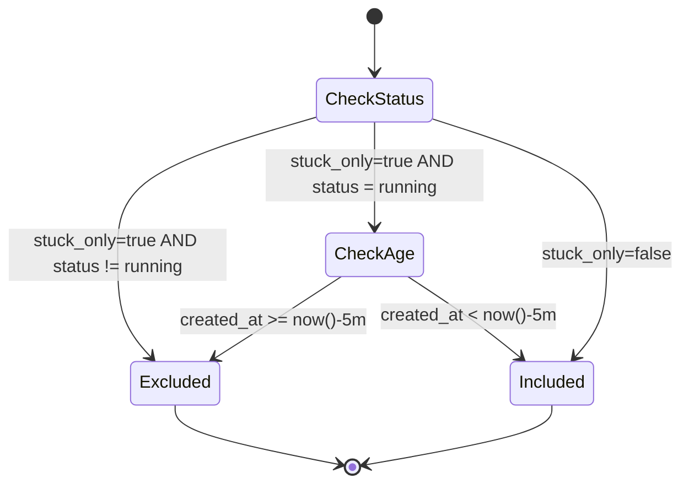

[← HPay Docs](../../../overview-v2.md) · repo hpay-backend + hpay-admin · plan · solution architecture

# Solution Architecture — Workflow Instances Filters

> Companion to [implementation-plan.md](./implementation-plan.md). The same `listing.Filter` pattern already used for the audit log / fraud flags, plus 3 parameters specific to this page (status/definition/stuck_only) because the UI already has 3 controls for exactly those 3 dimensions.

## 1. Context

## 2. Main flow

## 3. State — stuck_only is a consequence of status + age, not a separate column

## 4. Data model delta

No new table/column — only the query changes on the existing schema.

## 5. Decisions & trade-offs

| Decision | Alternative | Why |
| --- | --- | --- |
| Map "waiting"→"waiting_approval" at the API layer, do not change the DB enum | Change the UI to display "waiting_approval" | Keeps the label short for operators; the DB enum is an implementation detail and should not leak into the UI |
| `stuck_only` computed as `created_at < now() - interval '5 minutes'` in SQL | Compute in Go then filter in memory | Same logic as the UI currently computes (`ageMin > 5`), but it must run over the whole table for pagination to be correct — moved entirely down into SQL |
| `definition` filtered with ILIKE on `d.name` | Change the dropdown to send `definition_id` (UUID) for exact matching | Preserves the dropdown's current behavior (comparing by display name), avoiding extra UI/mapping changes |

## 6. Invariants touched

No financial invariants — a pure read path for the operations monitoring screen (Ops Monitor); it posts no ledger entries and changes no workflow state.

---
HPay · plan generated by skill `gen-feature-plan` · repo hpay-backend + hpay-admin · 2026-07-24
