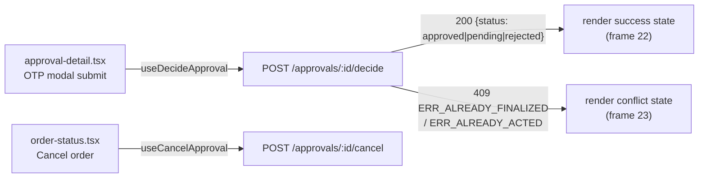
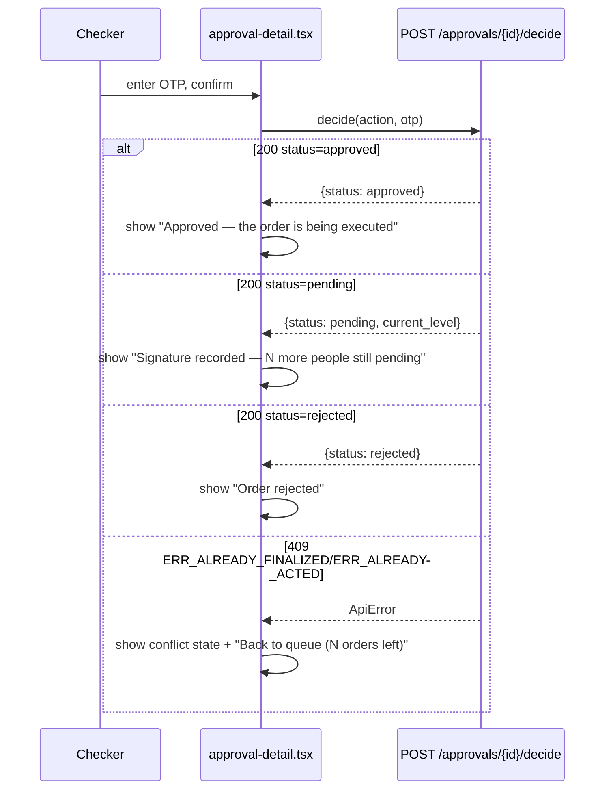
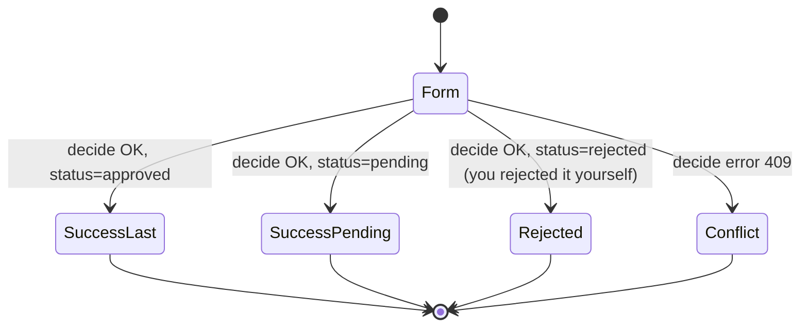

[← HPay Docs](../../../README.md) · repo hpay-mobile · [plan](implementation-plan.md) · solution architecture

# Solution Architecture — Checker OTP Result & Conflict Screens

Companion to [implementation-plan.md](./implementation-plan.md). All result states are derived from `DecideResult` (success) or `ApiError.code` (conflict) — no UI state exists independently of the backend response.

## 1. Context

## 2. Main flow

## 3. State — UI state is a pure mapping from the response, not stored in parallel

## 4. Data model delta

None — uses the existing `DecideResult` and `ApiError.code` as-is (the Vietnamese messages already exist in `src/lib/errors.ts`).

## 5. Decisions & trade-offs

| Decision | Alternatives | Why |
|---|---|---|
| Local state inside the same screen, no separate route | A dedicated `/approval-result` route | The content of the 2 frames merely replaces the existing `ScrollView` part, with no need for separate navigation/params — keeps complexity at the level actually needed |
| Conflict catches exactly the 2 codes `ERR_ALREADY_FINALIZED`/`ERR_ALREADY_ACTED` | Treat every decide error as a "conflict" | Other errors (wrong OTP, expired, wrong level) call for entirely different copy/actions (retry the OTP, not "back to queue") — lumping them together would show the wrong message |

## 6. Invariants touched

No financial invariant — only changes how the result is presented and does not change the request/response contract of `decide`.

HPay · plan generated by the `gen-feature-plan` skill · repo hpay-mobile · 2026-07-24
