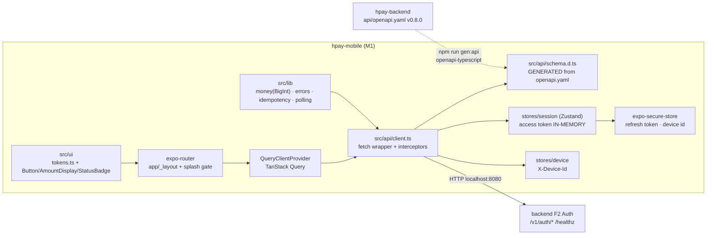
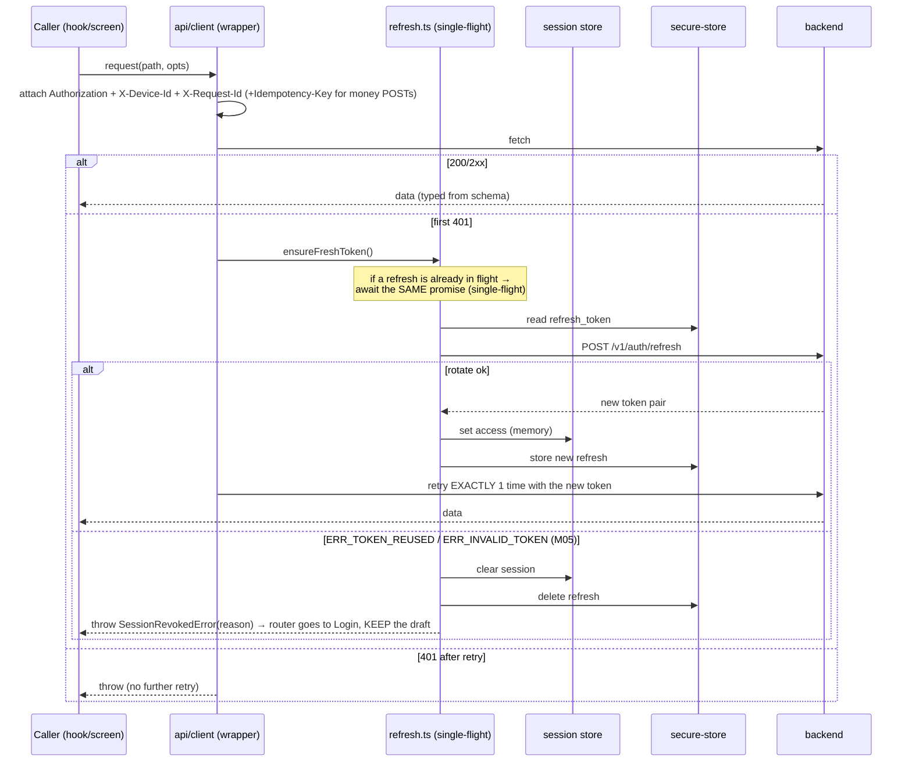
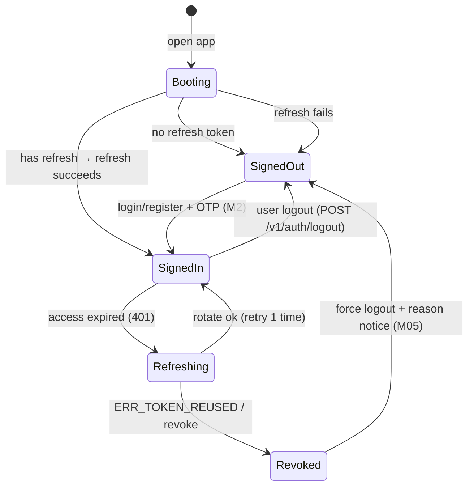
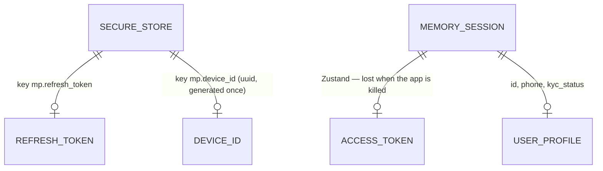

# 🏗 Solution Architecture — M1 Foundation

## 1. Context — where M1 sits in the system

## 2. Main flow — authenticated request + 401 single-flight refresh (M04/M05)

## 3. State — client-side session lifecycle

## 4. Data model delta

No DB. Durable client-side state:

## 5. Decisions & trade-offs

| Decision | Alternatives | Why |
|---|---|---|
| Thin hand-written fetch wrapper on top of the openapi-typescript types | openapi-fetch, axios, orval | Full control over the interceptors (single-flight, idempotency, retry-once) — this logic is a hard requirement of M01/M04; fewer dependencies |
| Access token in Zustand memory, NOT persisted | secure-store for both tokens | Rule doc 02 §5; access token lasts 15 minutes — losing it when the app is killed is acceptable, refresh handles the rest |
| Money = BigInt end-to-end, formatted with string ops | Number + Intl.NumberFormat | Index invariant §8: no float; Intl takes a number → write our own thousands formatting on strings |
| Polling helper + TransactionWatcher interface | websocket/SSE | Doc 02 §6: v1 has no realtime; leave an interface to swap in later |
| Idempotency-Key generated when ENTERING the confirm screen (hook), not when the button is pressed | generate inside onPress | M01: double-tap/re-render still yields 1 key → backend dedupes and returns the original 200 |

## 6. Invariants touched (index.html §8)

| Invariant | How M1 upholds it |
|---|---|
| Money is BIGINT minor units — no float | `lib/money.ts` exposes only a string/BigInt API; test M06 blocks the Number path |
| A retry must not create a duplicate transaction | Idempotency-Key once per flow (M01) + retry-once after refresh keeps the same key |
| Biometric only unlocks the app — money always needs PIN/OTP | Foundation does not put biometric into the transaction auth flow; noted in the gen-screen skill |

No token/OTP/balance is logged to the console — `lib/log.ts` redacts + strips in production; the balance is HIDDEN by default (UI state in M3).

hpay-mobile · docs/plans/m1-foundation · 17/07/2026
