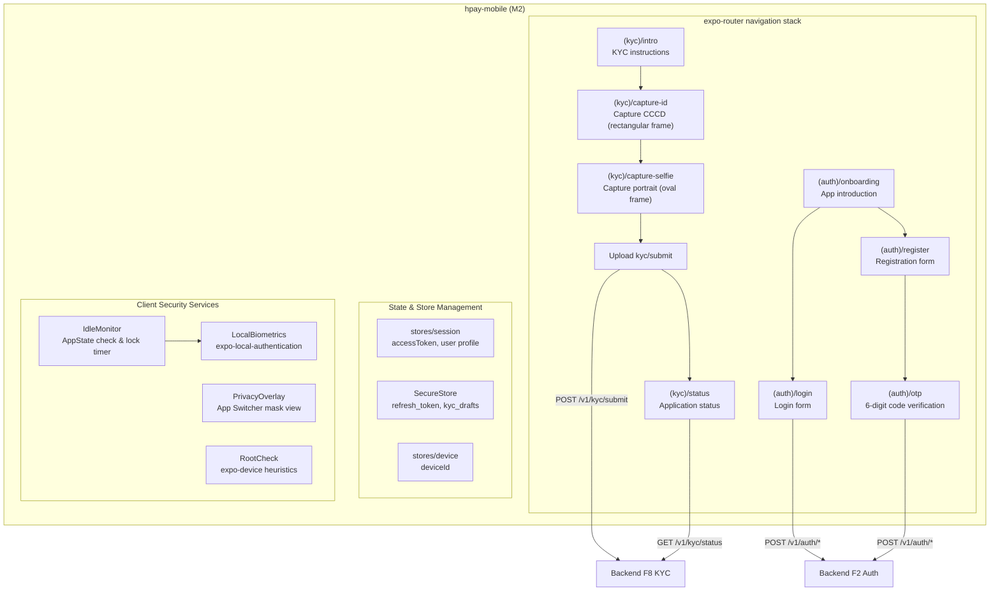
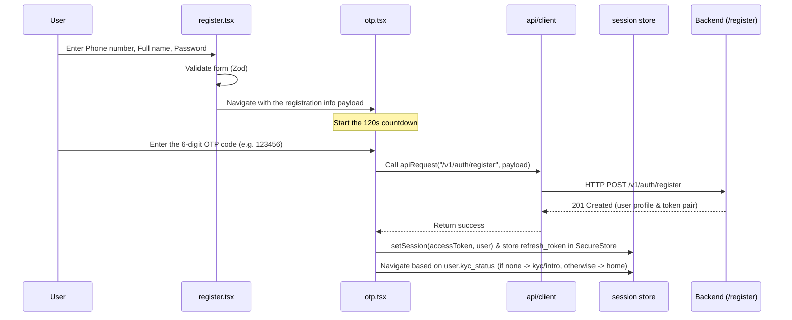
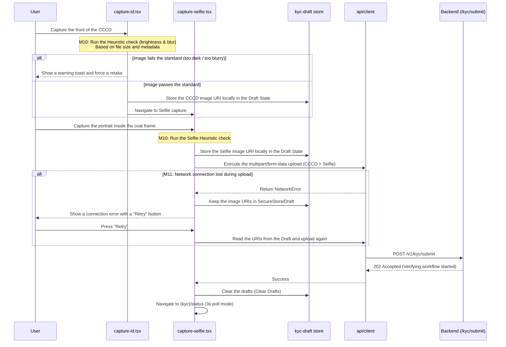
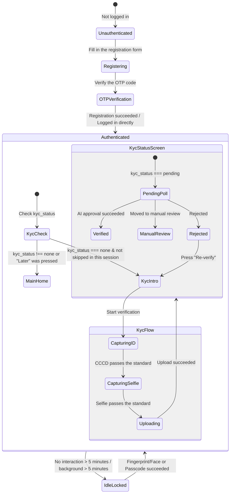
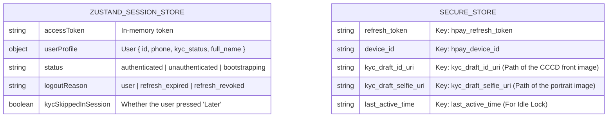

# 🏗 Solution Architecture — M2 Auth & KYC

## 1. Context — where M2 sits and navigation in the app

## 2. Main flow — Detailed business flows

### A. Registration & OTP verification (Simulated OTP Flow)

Because the backend creates the user and issues the JWT directly at the `/v1/auth/register` endpoint, the client app is designed with the flow: enter information → simulated OTP verification on the client side → call the register API. This design both gives the end user an OTP experience and matches the API contract with the backend.

### B. KYC flow, Client-Side Heuristic and Resume Upload (M10/M11)

The process of capturing the CCCD document and portrait photo, performing a rough image quality check before upload, and the recovery/resume-upload mechanism when the network connection is interrupted.

## 3. State — User state lifecycle

## 4. Data model delta — Client-side storage state

## 5. Decisions & trade-offs — Technical decisions

| Decision | Alternatives | Rationale & trade-off assessment |
|---|---|---|
| Simulate the OTP flow on the client side during registration | Force the backend to change the API | The backend already finished F2. Simulating ensures the FE has a high-quality OTPInput UI matching the design spec without disturbing the frozen contract-first API contract. |
| Rough image-quality heuristic via file size and image resolution | Send the image to the server/AI for direct analysis | Saves bandwidth and detects poor-quality images immediately (e.g. a file that is too small, < 50KB, is usually blurry or a camera render error), optimizing the instant-retake experience. |
| AppState overlay that covers the screen with a thin full-screen View instead of blocking screenshots at the native level | Integrate a Native library that blocks screenshots | Maximum compatibility with Expo Go and Android/iOS devices without deep Gradle/Xcode configuration changes of the Expo bare workflow. On real devices at release, a security flag can be added later. |

## 6. Invariants touched (index.html §8)

| Invariant | How M2 complies |
|---|---|
| Money transfers always need PIN/OTP; Biometrics only unlocks the app | The biometric unlock is used only in `useLocalUnlock` to dismiss the 5-minute Idle Lock screen. It never stores transfer credentials or auto-signs transactions via biometrics. |
| Never log tokens/OTP to the console | Completely disable printing the entered OTP and tokens in `console.log` via Babel's strip-logs configuration in production build mode. |

hpay-mobile · docs/plans/m2-auth-kyc · 18/07/2026
