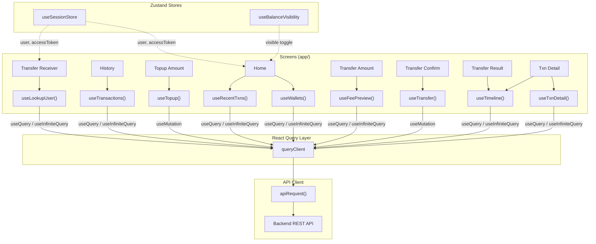
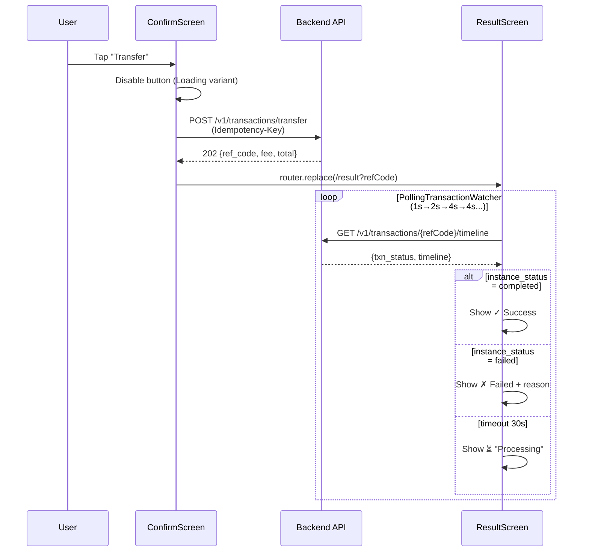

# 🏗 Solution Architecture — M3 Core Screens & Flows mobile

Detailed architecture for the main screens of `hpay-mobile`: state management, the hooks → screens data flow, component contracts and error-handling patterns.

## 1. Architecture overview



## 2. Feature directory structure

```
src/features/wallet/
├── hooks/
│   ├── useWallets.ts          ← GET /v1/wallets → cached balance
│   ├── useTransactions.ts     ← GET /v1/transactions (useInfiniteQuery)
│   ├── useTxnDetail.ts        ← GET /v1/transactions/{refCode}
│   ├── useTimeline.ts         ← GET /v1/transactions/{refCode}/timeline
│   ├── useTopup.ts            ← POST /v1/wallets/topup (useMutation)
│   ├── useTransfer.ts         ← POST /v1/transactions/transfer (useMutation)
│   ├── useFeePreview.ts       ← GET /v1/fees/preview?amount (useQuery, enabled when amount>0)
│   └── useLookupUser.ts       ← Look up a user by phone number (debounced)
├── components/
│   ├── QuickActions.tsx        ← 4 quick action buttons (Home)
│   ├── RecentTransactions.tsx  ← List of the 5 most recent transactions (Home)
│   ├── TransactionList.tsx     ← Full list + grouped by date (History)
│   └── TransferSummary.tsx     ← Transfer confirmation summary table
├── stores/
│   └── balance-visibility.ts   ← Zustand store for the balance hide/show toggle
├── helpers/
│   ├── txn-direction.ts        ← Determine in/out based on wallet ownership
│   ├── txn-group-by-date.ts    ← Group transactions by date headers
│   └── kyc-limits.ts           ← Map KYC status → transaction limit
└── __tests__/
    ├── useWallets.test.ts
    ├── useTransactions.test.ts
    ├── useTopup.test.ts
    ├── useTransfer.test.ts
    ├── txn-direction.test.ts
    └── txn-group-by-date.test.ts

src/ui/
├── AmountInput.tsx             ← [NEW] Large amount input with live formatting
├── TxnListItem.tsx             ← [NEW] Transaction list item
├── TimelineStep.tsx            ← [NEW] Workflow step timeline item
├── FilterChips.tsx             ← [NEW] Chip group for filtering
├── BalanceCard.tsx             ← [NEW] Balance card with hide/show toggle
├── EmptyState.tsx              ← [NEW] Empty list placeholder
├── ErrorState.tsx              ← [NEW] Error with retry
├── Skeleton.tsx                ← [NEW] Loading skeleton placeholder
├── AmountDisplay.tsx           ← [EXISTS] Reuse
├── Button.tsx                  ← [EXISTS] Reuse (Loading variant)
├── StatusBadge.tsx             ← [EXISTS] Reuse
├── tokens.ts                   ← [EXISTS] Design tokens
└── index.ts                    ← [UPDATE] Export new components
```

## 3. Hook specifications

### 3.1. useWallets

```
// src/features/wallet/hooks/useWallets.ts
import { useQuery } from '@tanstack/react-query';
import { apiRequest } from '@/src/api/client';

interface WalletRow {
  id: string;
  currency: string;
  purpose: string;
  label: string | null;
  balance: number; // int64 from BE, safe as number up to ~9 quadrillion VND
}

interface WalletsResponse {
  wallets: WalletRow[];
}

export const WALLETS_QUERY_KEY = ['wallets'] as const;

export function useWallets() {
  return useQuery({
    queryKey: WALLETS_QUERY_KEY,
    queryFn: () => apiRequest<WalletsResponse>('/v1/wallets'),
    staleTime: 15_000, // balance should feel fresh
  });
}

/** Convenience: extract main wallet balance as BigInt for AmountDisplay. */
export function useMainBalance() {
  const { data, ...rest } = useWallets();
  const main = data?.wallets.find(w => w.purpose === 'main');
  return { balance: main ? BigInt(main.balance) : 0n, ...rest };
}
```

### 3.2. useTransactions (infinite)

```
// src/features/wallet/hooks/useTransactions.ts
import { useInfiniteQuery } from '@tanstack/react-query';
import { apiRequest } from '@/src/api/client';

interface TxnRow {
  id: string;
  ref_code: string;
  type: 'topup' | 'p2p' | 'fee' | 'reversal' | 'org_disbursement' | 'vault_move';
  status: 'created' | 'processing' | 'processing_async' | 'completed' | 'failed' | 'reversed' | 'pending_approval';
  sender_wallet_id: string;
  receiver_wallet_id: string;
  amount: number;
  fee: number;
  note: string | null;
  created_at: string;
  completed_at: string | null;
}

interface TxnsResponse {
  transactions: TxnRow[];
  next_cursor: string;
  next_cursor_id: string;
}

export const TRANSACTIONS_QUERY_KEY = ['transactions'] as const;

export function useTransactions() {
  return useInfiniteQuery({
    queryKey: TRANSACTIONS_QUERY_KEY,
    queryFn: async ({ pageParam }) => {
      const params = new URLSearchParams();
      if (pageParam?.cursor) params.set('cursor', pageParam.cursor);
      if (pageParam?.cursorId) params.set('cursor_id', pageParam.cursorId);
      const qs = params.toString();
      return apiRequest<TxnsResponse>(`/v1/transactions${qs ? `?${qs}` : ''}`);
    },
    initialPageParam: undefined as { cursor: string; cursorId: string } | undefined,
    getNextPageParam: (lastPage) => {
      if (!lastPage.next_cursor || lastPage.transactions.length === 0) return undefined;
      return { cursor: lastPage.next_cursor, cursorId: lastPage.next_cursor_id };
    },
  });
}
```

### 3.3. useTopup (mutation)

```
// src/features/wallet/hooks/useTopup.ts
import { useMutation, useQueryClient } from '@tanstack/react-query';
import { apiRequest } from '@/src/api/client';
import { WALLETS_QUERY_KEY } from './useWallets';
import { TRANSACTIONS_QUERY_KEY } from './useTransactions';

interface TopupResult {
  ref_code: string;
  status: string;
  amount: number;
  new_balance?: number;
  created_at: string;
  duplicate?: boolean;
}

export function useTopup() {
  const qc = useQueryClient();
  return useMutation({
    mutationFn: (args: { amount: number; idempotencyKey: string }) =>
      apiRequest<TopupResult>('/v1/wallets/topup', {
        method: 'POST',
        body: { amount: args.amount },
        idempotencyKey: args.idempotencyKey,
      }),
    onSuccess: () => {
      // Invalidate both wallets and transactions to reflect new balance + txn
      qc.invalidateQueries({ queryKey: WALLETS_QUERY_KEY });
      qc.invalidateQueries({ queryKey: TRANSACTIONS_QUERY_KEY });
    },
  });
}
```

### 3.4. useTransfer (mutation + polling)

```
// src/features/wallet/hooks/useTransfer.ts
import { useMutation, useQueryClient } from '@tanstack/react-query';
import { apiRequest } from '@/src/api/client';
import { WALLETS_QUERY_KEY } from './useWallets';
import { TRANSACTIONS_QUERY_KEY } from './useTransactions';

interface TransferResult {
  ref_code: string;
  status: string;
  amount: number;
  fee: number;
  total: number;
  created_at: string;
  duplicate?: boolean;
}

interface TransferArgs {
  receiver_phone: string;
  amount: number;
  note?: string;
  idempotencyKey: string;
}

export function useTransfer() {
  const qc = useQueryClient();
  return useMutation({
    mutationFn: (args: TransferArgs) =>
      apiRequest<TransferResult>('/v1/transactions/transfer', {
        method: 'POST',
        body: { receiver_phone: args.receiver_phone, amount: args.amount, note: args.note },
        idempotencyKey: args.idempotencyKey,
      }),
    onSuccess: () => {
      qc.invalidateQueries({ queryKey: WALLETS_QUERY_KEY });
      qc.invalidateQueries({ queryKey: TRANSACTIONS_QUERY_KEY });
    },
  });
}
```

## 4. Component contracts

### 4.1. AmountInput

```
// src/ui/AmountInput.tsx
interface AmountInputProps {
  /** Current display value (formatted string, e.g. "1.234.567"). */
  value: string;
  /** Called with the raw formatted value on each change. */
  onChangeText: (formatted: string) => void;
  /** Error text shown below input. */
  error?: string;
  /** Placeholder text (default "0"). */
  placeholder?: string;
  /** Auto-focus on mount. */
  autoFocus?: boolean;
  /** Disable input. */
  disabled?: boolean;
}
// Renders: large centered number, "₫" suffix muted, error text below.
// Uses formatAmountWhileTyping() from lib/money.ts on every keystroke.
// keyboardType="numeric", selectionColor=brand[600].
```

### 4.2. TxnListItem

```
// src/ui/TxnListItem.tsx
interface TxnListItemProps {
  type: 'topup' | 'p2p' | 'fee' | 'reversal';
  direction: 'in' | 'out';    // derived from wallet ownership
  amount: bigint;              // minor units
  status: Status;              // from StatusBadge
  counterpartyName?: string;   // masked name or "Top up" for topup
  note?: string;               // 1-line ellipsis
  createdAt: string;           // ISO string → relative time
  onPress: () => void;         // navigate to detail
}
// Layout: [Icon] [Name + note] [AmountDisplay + StatusBadge]
// Icon: ↓ green for in, ↑ neutral for out, ↩ for reversal.
```

### 4.3. TimelineStep

```
// src/ui/TimelineStep.tsx
type TimelineStepStatus = 'done' | 'active' | 'failed' | 'waiting';

interface TimelineStepProps {
  label: string;
  status: TimelineStepStatus;
  timestamp?: string;  // shown when done/failed
  isLast?: boolean;     // no connector line below
}
// Visual: vertical line + circle (colored per status) + label + timestamp.
// done=green filled, active=blue pulsing, failed=red X, waiting=gray outline.
```

### 4.4. BalanceCard

```
// src/ui/BalanceCard.tsx
interface BalanceCardProps {
  balance: bigint;
  visible: boolean;
  onToggleVisibility: () => void;
  isLoading?: boolean;
}
// Card with gradient background (brand-600 → brand-700).
// Shows AmountDisplay(display size) when visible, "••••••" when hidden.
// Eye icon toggles visibility.
// Skeleton shimmer when isLoading.
```

### 4.5. FilterChips

```
// src/ui/FilterChips.tsx
interface FilterChipsProps<T extends string> {
  options: { key: T; label: string }[];
  selected: T;
  onSelect: (key: T) => void;
}
// Horizontal ScrollView of chips. Selected = brand-600 bg + white text.
// Unselected = neutral-100 bg + neutral-700 text.
```

## 5. State management

### 5.1. Balance visibility store

```
// src/features/wallet/stores/balance-visibility.ts
import AsyncStorage from '@react-native-async-storage/async-storage';
import { create } from 'zustand';
import { createJSONStorage, persist } from 'zustand/middleware';

interface BalanceVisibilityState {
  visible: boolean;
  toggle: () => void;
}

export const useBalanceVisibility = create<BalanceVisibilityState>()(
  persist(
    (set) => ({
      visible: false, // default HIDDEN on app open (fintech best practice)
      toggle: () => set((s) => ({ visible: !s.visible })),
    }),
    { name: 'hpay-balance-vis', storage: createJSONStorage(() => AsyncStorage) },
  ),
);
```

 **Note:** `@react-native-async-storage/async-storage` must be installed for Zustand persist. Alternatively, use the `expo-secure-store` that is already present if desired — but SecureStore is not suitable for non-sensitive preferences. The simplest approach will be used: a custom storage adapter on SecureStore (already in the project).

### 5.2. Transfer flow state

The transfer flow state is managed through **expo-router params** between the steps — no dedicated Zustand store is needed:

```
// Flow: receiver.tsx → amount.tsx → confirm.tsx → result.tsx
// Params passed through the router:

// receiver.tsx → amount.tsx
router.push({ pathname: '/transfer/amount', params: { receiverPhone, receiverName } });

// amount.tsx → confirm.tsx
router.push({ pathname: '/transfer/confirm', params: { receiverPhone, receiverName, amount, note } });

// confirm.tsx → result.tsx
// After the mutation succeeds:
router.replace({ pathname: '/transfer/result', params: { refCode } });
// replace() so the user cannot go back to confirm and submit again.
```

## 6. Transfer polling flow



## 7. Transaction direction logic

```
// src/features/wallet/helpers/txn-direction.ts

/**
 * Determines if a transaction is incoming or outgoing relative to the user's wallet.
 * This is the SINGLE source of truth for sign/color in TxnListItem and AmountDisplay.
 */
export function getTxnDirection(
  txn: { type: string; sender_wallet_id: string; receiver_wallet_id: string },
  myWalletId: string,
): 'in' | 'out' {
  // Topup is always "in" for the user
  if (txn.type === 'topup') return 'in';
  // Reversal: if I was the original receiver getting money back → "in";
  // if I was the sender getting refund → "in" too (reversal credits back)
  if (txn.type === 'reversal') {
    return txn.receiver_wallet_id === myWalletId ? 'in' : 'out';
  }
  // P2P / org_disbursement: receiver = me → "in", sender = me → "out"
  return txn.receiver_wallet_id === myWalletId ? 'in' : 'out';
}
```

## 8. Date grouping logic

```
// src/features/wallet/helpers/txn-group-by-date.ts

interface DateGroup<T> {
  title: string;        // "Today", "Yesterday", "12/07/2026"
  data: T[];
}

/**
 * Groups transactions by date for SectionList.
 * Uses Asia/Ho_Chi_Minh timezone for day boundaries.
 */
export function groupByDate<T extends { created_at: string }>(items: T[]): DateGroup<T>[] {
  // 1. Parse each created_at to local date string
  // 2. Group into Map<dateString, T[]>
  // 3. Convert to DateGroup[] with human-readable titles
  //    - Today → "Today"
  //    - Yesterday → "Yesterday"
  //    - Otherwise → "DD/MM/YYYY"
}
```

## 9. KYC limits mapping (client-side)

```
// src/features/wallet/helpers/kyc-limits.ts

/** Mirrors backend wallet.TxnLimit() — must stay in sync. */
export function getKycLimit(kycStatus: string): bigint {
  switch (kycStatus) {
    case 'verified':
    case 'auto_approved':
      return 100_000_000n;  // 100M VND
    case 'pending':
    case 'manual_review':
      return 5_000_000n;    // 5M VND
    default: // 'none', 'rejected'
      return 2_000_000n;    // 2M VND
  }
}

export function formatKycTierName(kycStatus: string): string {
  switch (kycStatus) {
    case 'verified': case 'auto_approved': return 'Verified';
    case 'pending': case 'manual_review': return 'Verifying';
    default: return 'Not verified';
  }
}
```

## 10. Error handling patterns

### 10.1. Mutation errors

```
// Transfer / Topup mutations handle errors via onError callback.
// Map backend error codes to Vietnamese user-friendly messages:

const ERROR_MAP: Record<string, string> = {
  ERR_AMOUNT_INVALID: 'Invalid amount',
  ERR_LIMIT_EXCEEDED: 'Exceeds the allowed transaction limit',
  ERR_SELF_TRANSFER: 'Cannot transfer money to yourself',
  ERR_INSUFFICIENT_BALANCE: 'Insufficient balance',
  ERR_RECEIVER_NOT_FOUND: 'Recipient not found',
  ERR_IDEMPOTENCY_KEY_REQUIRED: 'System error, please try again',
};

// isApiError() from lib/errors.ts detects API errors.
// Display via toast/inline error text — never throw to screen boundary.
```

### 10.2. Query errors

React Query retry (max 2, backoff) handles transient failures. 401 → automatic refresh via `unauthorizedHandler` (M04, already implemented in M1). Non-retryable 4xx → `ErrorState` component with retry button.

## 11. Performance considerations

- **FlatList vs FlashList:** Start with RN `FlatList` for History. Monitor — if scroll perf degrades at 100+ items, swap to `@shopify/flash-list`.
- **React Query staleTime:** Wallets = 15s (balance should feel fresh). Transactions = 30s (default). Fee preview = 0 (always fresh).
- **Amount formatting:** `formatAmountWhileTyping` is called on every keystroke — already pure and fast (regex + string ops only). No memo needed.
- **Infinite query:** `maxPages` not set — user can scroll through full history. If memory becomes concern, set `maxPages: 10` (200 items).
- **Balance card gradient:** Use `LinearGradient` from `expo-linear-gradient` (already a transitive dep of Expo).

hpay-mobile · docs/plans/m3-core-screens/ · 18/07/2026
