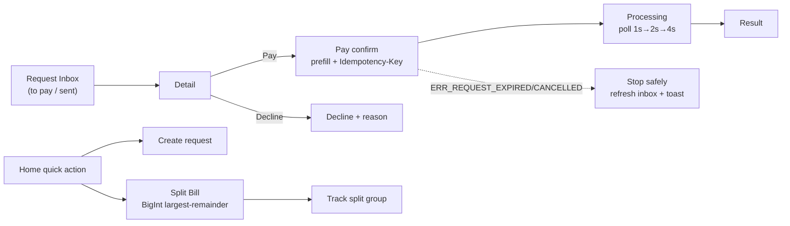

# 📋 Implementation Plan — M4 Request Money · Split Bill · QR · Account mobile

Phase that builds **Request Money** (asking for money), **Split Bill**, **QR for receiving money** (backend-gated), the real **Account** screen, together with the **`#1ecbe1` primary-color rebrand** of the mobile/admin design and paying off the M12 debt (FlashList).

Backend dependency: the money-requests API **already exists in full** in `openapi.yaml` (create/split/inbox/sent/detail/pay/decline/cancel). Only QR needs the backend phase `m4-api-support` (see §6).

## 1. Scope & non-goals

### Ships

- **T0 Rebrand `#1ecbe1`:** change only the product's design files — `src/mobile/src/ui/tokens.ts`, the token table in `docs/design/ui-design-spec.html`, `design/mockups/mp-base.css` + the color variables in the mockups. **DO NOT** change the chrome look of the other docs pages. `#1ECBE1` is used as the accent (hero, gradient, active icon); the darker steps `#0E90A3`/`#0B7181` are for button/link/pressed to reach AA contrast with white text.
- **Request Money** (mockups 25–27): create a request, Inbox with 2 tabs "To pay / Sent by me", detail, Pay (prefill confirm → reuse the transfer confirm/processing flow), Decline (with a reason), Cancel a request I sent.
- **Split Bill** (mockups 28–29): split evenly / custom — preview using BigInt largest-remainder (no float), the server is the source of truth; a split group tracking screen.
- **Real Account screen**: profile from `/v1/users/me`, KYC status + limits, biometric toggle, balance hidden by default, logout. Fix the "coming in M3" text bug.
- **M3 debt — edge M12:** history moves from `SectionList` → `FlashList`, keeping cursor pagination unchanged.
- **QR for receiving money** (mockup 16) — GATED: code only after the backend `m4-api-support` is merged + `npm run gen:api`.

### Non-goals

- Vaults / round-up (mockups 30–31) — no backend contract yet, backlog.
- The "Remind" button (mockup 29) — no remind endpoint yet, mobile hides the button, backlog.
- Business maker/checker (M5); real push notifications.

## 2. Tasks

| # | Task | Main files | Size | Depends |
|---|---|---|---|---|
| T0 | Rebrand tokens: brand scale from `#1ecbe1`, update tokens.ts + design spec + mp-base.css/mockups | `src/ui/tokens.ts`, docs/design | S | — |
| T1 | `npm run gen:api` — sync the money-requests types | `src/api/` | S | — |
| T2 | Feature `money-request`: TanStack Query hooks + Idempotency-Key for create/split/pay | `src/features/money-request/` | M | T1 |
| T3 | Screens: create, inbox with 2 tabs, detail | `app/(main)/requests/` | M | T2 |
| T4 | Pay request: prefill confirm → pay → Processing (reuse the watcher); expiry/cancel race → stop safely | `app/(main)/requests/pay.tsx` | M | T2 |
| T5 | Split Bill: even/custom split form + tracking screen; `src/lib/split.ts` pure BigInt | `app/(main)/requests/split*.tsx` | M | T2 |
| T6 | Real Account screen | `app/(main)/account.tsx`, `src/features/account/` | M | — |
| T7 | History → FlashList (M12) | `app/(main)/history.tsx` | S | — |
| T8 | GATED QR receive + scan inside transfer (verify via API, do not trust the raw QR) | `app/(main)/qr.tsx` | M | backend m4-api-support |
| T9 | Edge tests (§4) + client review checklist | `__tests__` | M | T2–T8 |

## 3. Main flow



## 4. Edge tests (jest, prefix TestEdge_)

| Test | Cover |
|---|---|
| `TestEdge_M01_PayRequestDoubleTap` | Double-tap "Pay now" → exactly 1 request, the key is generated when entering confirm |
| `TestEdge_M02_PayRequestTimeout` | Timeout after POST pay → Processing, do not report failure prematurely |
| `TestEdge_M06_SplitBigIntRounding` | 840000/4, 100000/3… largest-remainder, the total matches exactly, no float |
| `TestEdge_M12_HistoryFlashListPagination` | Cursor pagination + pull-to-refresh does not jump position |
| `TestEdge_E19_PayExpiredRequest` | Request cancelled/expired mid pay flow → stop safely before money is debited |
| `TestEdge_QRUntrustedPayload` *(gated T8)* | Raw QR not verified via the API → prefill rejected |

## 5. Rebrand #1ecbe1 & reducing the "AI look"

**Brand scale:** 50 `#E6FAFD` · 100 `#C9F4FA` · 300 `#64DDEC` · **400 `#1ECBE1` (original accent)** · 600 `#0E90A3` (primary button/link — AA on white) · 700 `#0B7181` (pressed) · 900 `#073F48`. `#1ecbe1` is too bright as a button background with white text (contrast ~1.9:1), so it is kept as the identity color; steps 600/700 are for interactive elements.

**Reducing the "AI look":** drop emoji as system icons (use a consistent icon set), reduce default gradients, increase whitespace, use `tabular-nums` for numbers. Applied gradually to the M4 screens it touches; older screens get fixed in the M5 polish pass.

**Scope:** change only the product design files (tokens.ts, ui-design-spec, mockups). Do not change the styles of the other hpay-docs pages.

## 6. Contract gap — backend needed first (contract-first)

| Proposed endpoint | Reason |
|---|---|
| `GET /v1/users/me/qr` → `{payload, signature, expires_at}` (server-side HMAC, user_id + masked phone) | Doc 02 §5: the QR must be a signed payload, the client does not generate it itself |
| `POST /v1/qr/resolve` `{payload, signature}` → masked receiver + receiver token | The scanning side does not trust the raw QR, it verifies via the API |

→ Backend does phase `m4-api-support` + updates `openapi.yaml`; only after it is merged does mobile code T8.

## 7. Verify

```
npm run typecheck && npm run lint && npm test
npx expo start   # manual: request flow, split, account, QR (after T8)
```
