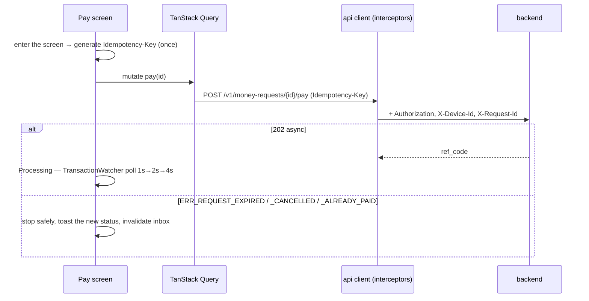
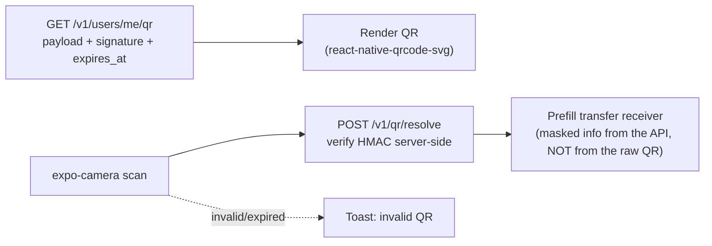

# 🏗 Solution Architecture — M4 mobile

## 1. New folder structure

```
app/(main)/
├── requests/
│   ├── _layout.tsx      # Stack for the requests flow
│   ├── index.tsx        # Inbox with 2 tabs: to pay / sent by me
│   ├── create.tsx       # Create a request (receiver lookup reused from transfer)
│   ├── [id].tsx         # Detail (with split siblings if part of a split group)
│   ├── pay.tsx          # Prefill confirm → pay → Processing (reuse the watcher)
│   ├── split.tsx        # Split evenly / custom
│   └── split-group.tsx  # Track the split group
├── account.tsx          # Real Account (replaces the placeholder)
└── qr.tsx               # [GATED backend] QR for receiving money

src/features/money-request/   # hooks.ts + __tests__/
src/features/account/         # users/me hooks, settings binding
src/lib/split.ts              # largest-remainder BigInt (pure, unit-tested)
```

## 2. Data flow — Pay request (reusing the transfer infrastructure)



**Principle:** pay request = a transfer that originates from a request. Do not duplicate the flow — `pay.tsx` reuses the transfer's confirm/processing components with hard-locked prefilled data (the amount cannot be edited), still going through PIN per the doc 02 auth matrix (biometric only unlocks the app).

## 3. Split — money never goes through float

`src/lib/split.ts`: `splitEven(total: bigint, n: number): bigint[]` — divide the integer part, spread the remainder by largest-remainder (+1 minor unit from the start of the list). Custom mode: validate `sum(parts) === total` with BigInt. The client preview is for display only — the server recomputes and is the source of truth (`split_group_id` from the 201 response).

## 4. State

| Kind | Where it lives |
|---|---|
| Inbox/sent/detail/split group | TanStack Query — key `['money-requests', …]`, invalidated after pay/decline/cancel; inbox refetches on focus |
| Draft of create request / split | Local screen state (lost on leaving — accepted for v1); amount string→BigInt via the existing `src/lib/money.ts` |
| Account settings (hide balance, biometric) | The existing Zustand store — persist non-sensitive data; tokens remain in SecureStore |

## 5. QR GATED — backend m4-api-support



Cache the QR payload in Query with `staleTime < expires_at`.

## 6. Rebrand token mapping (product design files only)

| Token | Old | New | Used for |
|---|---|---|---|
| `brand.400` (new) | — | `#1ECBE1` | Accent, hero, BalanceCard gradient, active icon |
| `brand.600` | `#0B5FFF` | `#0E90A3` | Primary button, link (AA on white) |
| `brand.700` | `#0A4FD6` | `#0B7181` | Pressed |
| `brand.50` | `#EBF1FF` | `#E6FAFD` | Chip/badge background |

Synchronized across: `src/mobile/src/ui/tokens.ts` + `docs/design/ui-design-spec.html` (token table) + `design/mockups/mp-base.css` and the color variables in the mockups — admin A1 will read from there later. Do not change the styles of the other docs pages.

## 7. Risks

| Risk | Mitigation |
|---|---|
| Pay vs cancel/expire race (E19) | The server is the gate; the client maps ERR_* → stop safely + invalidate; dedicated test |
| FlashList changes history scroll behavior | Keep the cursor logic intact, change only the renderer; test M12 |
| Rebrand touches every screen | Change only via tokens.ts — no hard-coded colors in components (convention since M1) |
