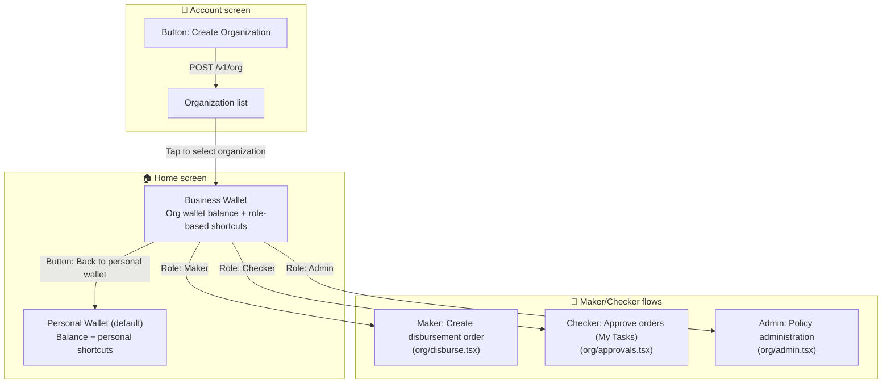
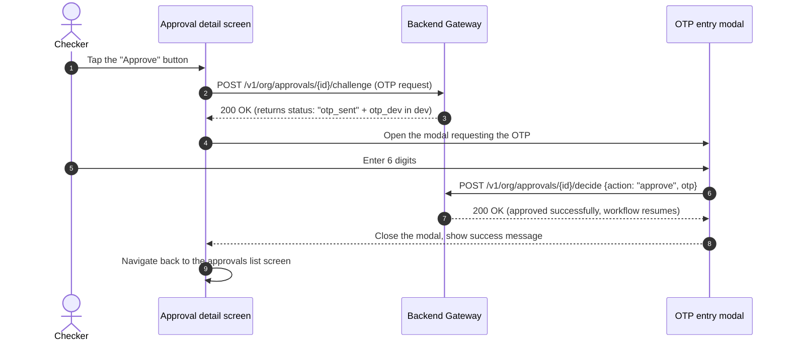

[← implementation-plan](implementation-plan.md) · m5-business-wallet

# M5 Business Wallet — Solution Architecture

## 1. Context & Screen Flow



## 2. State Management — Zustand store

To store the active organization state independently of the login session, we set up `useOrgStore`:

```
interface ActiveOrg {
  orgId: string;
  name: string;
  role: 'admin' | 'maker' | 'checker';
  checkerLevel: number;
  walletId: string;
  balance: bigint;
}

interface OrgState {
  activeOrg: ActiveOrg | null;
  switchOrg: (org: ActiveOrg) => void;
  exitOrg: () => void;
  updateBalance: (balance: bigint) => void;
}

```

## 3. Sequence Diagram — Checker Approval execution



## 4. Dynamic Quick Actions on Home

| Role | Displayed shortcuts | Corresponding navigation |
|---|---|---|
| **Maker** | Create disbursement order · History · Personal wallet | `/(main)/org/disburse` · `/(main)/history` · Return to personal wallet |
| **Checker** | Approve orders (count) · History · Personal wallet | `/(main)/org/approvals` · `/(main)/history` · Return to personal wallet |
| **Admin** | Top up · Administration · History · Personal wallet | `/(main)/org/topup` · `/(main)/org/admin` · `/(main)/history` · Return to personal wallet |
