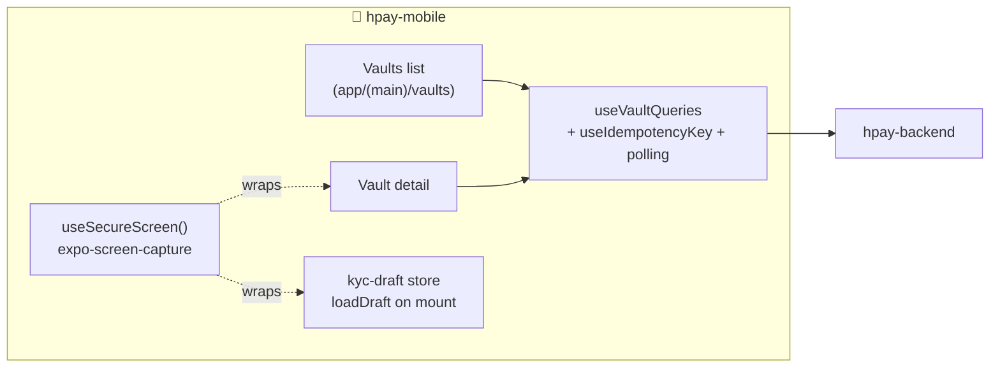
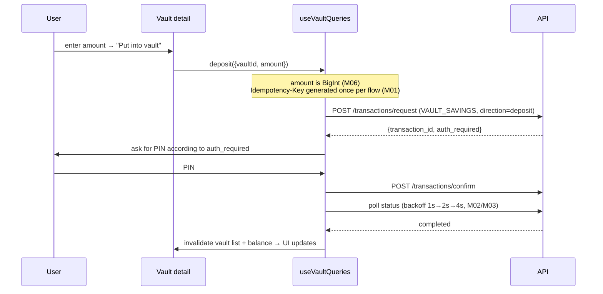
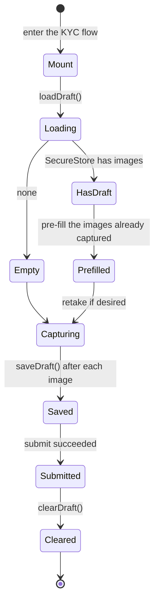
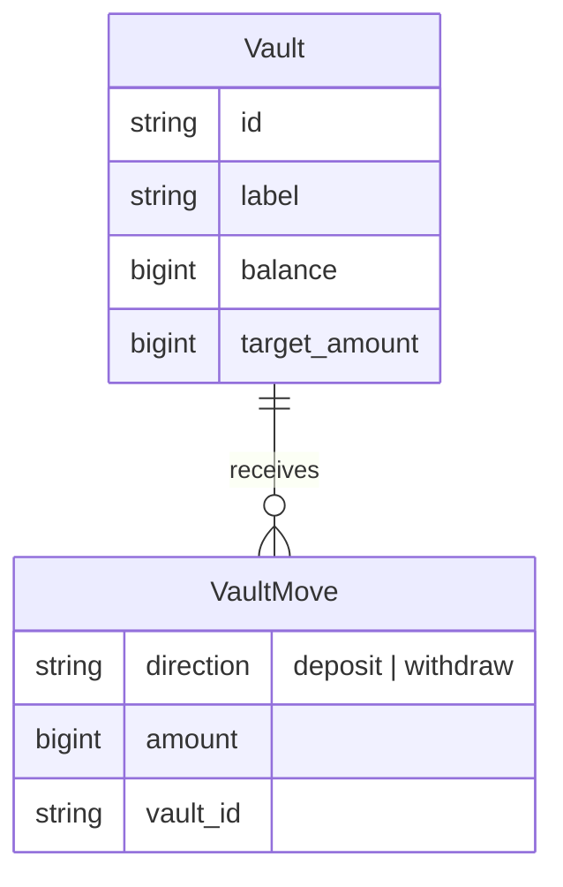

[← HPay Docs](../../../README.md) · repo `hpay-mobile` · [plan](implementation-plan.md) · solution architecture

# Solution Architecture — M6 Vaults & Hardening

Companion to [implementation-plan.md](./implementation-plan.md). All diagrams are mermaid.

## 1. Context

## 2. Main flow — depositing money into a vault

## 3. State — KYC draft restore (M11)

## 4. Data model delta

No new client-side state other than the vault data types generated from OpenAPI.

## 5. Decisions & trade-offs

| Decision | Alternatives | Why |
|---|---|---|
| Deposit/withdraw reuse the 3-step engine | A dedicated vault endpoint | Vaults inherit OfferGuard, the auth matrix and idempotency in full; no second money path is opened |
| Do not show a RoundUpToggle | Show it, disabled | The backend has no `ROUND_UP` step yet; a switch that does nothing misleads users into thinking the feature is live |
| `useSecureScreen()` per screen | Enable app-wide | Blocking screenshots app-wide prevents users from saving legitimate receipts; lock only where a balance/OTP/ID-document image appears |
| Wrap `expo-screen-capture` in try/catch | Call it directly | The module needs a native build; Expo Go would throw and crash the screen if not caught |
| `loadDraft` in the KYC flow's `_layout` | Call it in each capture screen | A single load point, avoiding the 2 screens overwriting each other's state |

## 6. Invariants touched

| Invariant | How it is kept |
|---|---|
| M06 — money never goes through float | Reuse the existing client's `parseAmountToBigInt` + `stringifyWithBigInt` |
| M01 — a double-tap does not create 2 transactions | `useIdempotencyKey` generates one key for the whole deposit/withdraw flow; the button is disabled while sending |
| M02/M03 — a timeout does not conclude failure | Use the existing `pollUntilSettled` instead of treating the timeout as an error |
| Biometric only unlocks the app | Deposit/withdraw still ask for PIN/OTP per the `auth_required` the server returns |
| Do not log sensitive data | Do not log the vault balance or the KYC image paths |

HPay · plan generated by the `gen-feature-plan` skill · repo hpay-mobile · 2026-07-23
