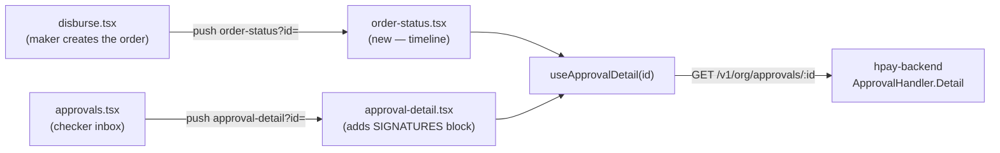
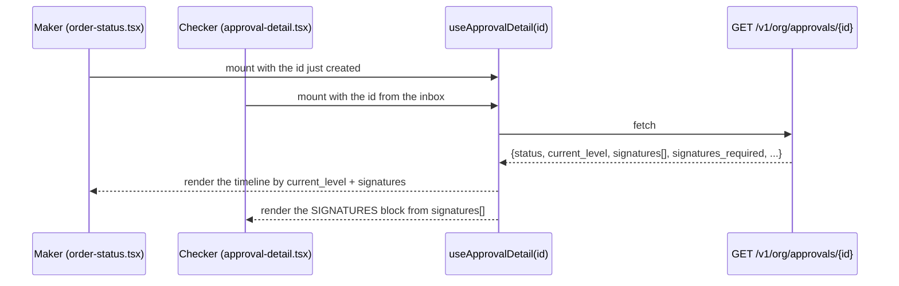
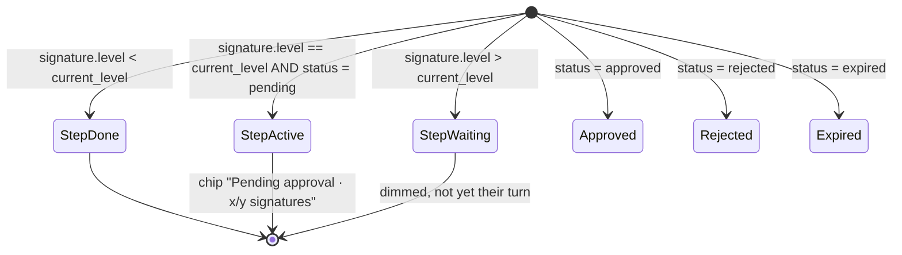

[← HPay Docs](../../../README.md) · repo `hpay-mobile` · [plan](implementation-plan.md) · solution architecture

# Solution Architecture — Maker Status & Checker Signatures

Companion to [implementation-plan.md](./implementation-plan.md). Both screens read from the same data source — `GET /v1/org/approvals/{id}` — differing only in presentation (a timeline for the maker, a signature list for the checker).

## 1. Context

## 2. Main flow

## 3. State — the timeline is derived from status + current_level, no separate state is stored

## 4. Data model delta

None — uses the response of `GET /v1/org/approvals/{id}` as-is (see the [backend solution-architecture](../../backend/approval-detail-endpoint/solution-architecture.md) §4).

## 5. Decisions & trade-offs

| Decision | Alternatives | Why |
|---|---|---|
| 1 shared hook (`useApprovalDetail`) for both screens | 2 separate hooks for maker/checker | Same DTO, same endpoint — splitting the hook only adds unnecessary maintenance cost |
| Timeline built from `current_level` + `signatures[]`, not a separate UI state | Keep progress in local state, updated manually | The server is always the source of truth; avoids the UI timeline diverging from the real state when 2 checkers race (E08) |
| Do not build the dedicated OTP-success/conflict screens (frame 22/23) this time | Build all 4 frames at once | Matches the scope the user requested ("more detail" for the 2 existing maker-status/checker-result screens); frames 22/23 are 2 entirely new screens, deferred to avoid an oversized PR |

## 6. Invariants touched

No financial invariant at the mobile layer — display of read data only; the approve/reject flow (OTP + `useDecideApproval`) stays unchanged.

HPay · plan generated by the `gen-feature-plan` skill · repo hpay-mobile + hpay-backend · 2026-07-24
