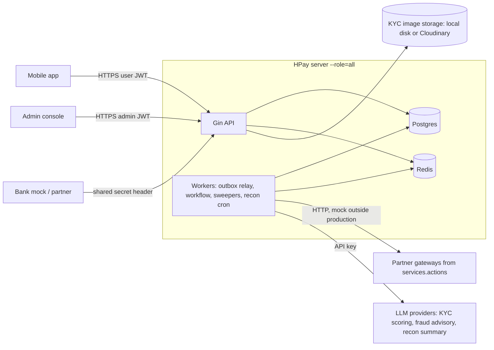

# Security model

Sources: `internal/api/{router,middleware,admin_handler}.go`, `internal/auth/*`, `internal/platform/config/config.go`, `internal/storage/*`, `cmd/seed/main.go`, `.gitignore`, `docs/audit/AUDIT-REPORT.md` (the verification appendix overrides the body). Status of every weakness below is **open** as of the 2026-11-21 audit and baseline; none was re-verified as fixed.

## 1. Trust boundaries

Boundaries: (1) client to API (untrusted input, JWT); (2) API to data stores (trusted network, no auth on Redis, compose exposes ports to the host); (3) workers to third parties (partner URLs configured in the database, LLM providers, Cloudinary); (4) the `/internal/mock-bank/callback` route, trusted only by a shared secret; (5) the admin surface, separated from users only by token audience and credentials.

## 2. Authentication and authorization layers

| Layer | Mechanism | Where |
|-------|-----------|-------|
| Passwords | argon2id (`golang.org/x/crypto/argon2`, m=64MiB, t=3, p=2 in the seeded hash) | `internal/auth` |
| User access token | JWT, audience `user`, TTL 15 minutes (`AccessTokenTTL`), signed with `JWT_SECRET` | `RequireAuth` |
| Refresh | rotating refresh tokens with reuse detection (`ErrTokenReused` revokes the family); mobile keeps the access token in memory and the refresh token in SecureStore | `auth` |
| Admin token | JWT audience `admin`, same `JWT_SECRET`, no refresh; stored in `sessionStorage` by the admin app | `RequireAdmin(adminIssuer)` |
| Admin roles | `admin_role` enum (`viewer`, `kyc_reviewer`, `risk_officer`, `ops`, `superadmin`) exists in the DB but routes do not enforce it: any valid admin token can use every admin route | BE-H6 |
| Org authorization | org membership and role (`admin`, `maker`, `checker`, checker level) checked in service-layer queries | `org`, `approval` |
| Maker-checker | approval policies with tiers, checker level match, unique action per checker, `FOR UPDATE` races handled; self-approval is blocked only in the admin flow | `approval` |
| Row ownership | owner-scoped queries, foreign ids return not found (vault, money request, wallet) | per module |
| Idempotency | `Idempotency-Key` header, attached to 2 routes only; global unique key | `RequireIdempotencyKey` |
| Rate limiting | Redis counters per IP and route (login 5/min, refresh 30/min, challenge 10/min) and per user (lookup 20/min, QR resolve 30/min); fails open if Redis fails | `middleware.go` |
| Transaction authentication (PIN/OTP) | modeled in the offer auth matrix, NOT enforced by the server (see BE-C2) | `transfer` |
| Mock bank callback | shared-secret header, no JWT, mounted in every environment | `mockbank_handler.go` |
| KYC image access | signed URLs (HMAC with `JWT_SECRET`, expiring) served by `/v1/files`; Cloudinary uploads default to public-by-URL | `storage` |
| Ledger integrity | append-only trigger (migration 000007), `CHECK balance >= 0` for non-system wallets, wallet locks in id order | DB |

## 3. Secrets handling

- Config comes from environment variables (`config.Load`); `godotenv` reads `./.env` in every environment (existing variables win). `.env` and `.env.*` are git-ignored, `.env.example` is tracked with placeholders only.
- Required: `DATABASE_URL`, `JWT_SECRET` (at least 32 bytes only when `APP_ENV` is not `dev`). Defaults: `APP_ENV=dev`, `MOCK_BANK_SECRET=dev-mock-bank-secret`.
- Cloudinary credentials come from env; AI provider keys are stored in plaintext in `ai_keys.api_key` (no encryption, no audit when changed).
- One `JWT_SECRET` signs user tokens, admin tokens and KYC file URLs.
- Fixed-password fixtures exist in `cmd/seed` (`Demo@123` for demo users, `E2ETest@123` for two e2e admins, only with `--e2e-admins`). The seeder refuses `APP_ENV=production` only, and `APP_ENV` is not validated.
- The audit found live credentials in a previous `.env` (database, Cloudinary, JWT secret); rotation was the first recommended action and must be assumed needed for any value that was in that file. Do not copy `.env` content into docs or chats.
- Files to keep out of git (already ignored): `.env*`, `*.pem`, `*.key`, `src/backend/data/`, `**/e2e/.auth/`, `*.exe`.

## 4. PII and KYC images

Data: national ID card image and selfie (KYC), phone numbers, names, transaction history, AI scores and reasons.

Current handling: images stored via `storage.Store` (local directory `KYC_STORAGE_DIR`, default `./data/kyc`, or Cloudinary); the admin sees them through signed, expiring URLs; the server checks only magic bytes (not a full decode), the key is always `id_card.jpg`; no `nosniff` header; no audit entry when a link is issued; KYC images are sent to a third-party LLM scorer (legal review needed); admin step-detail JSON masks PII (A07 e2e); `data/` is git-ignored.

Requirements for hardening: private/authenticated Cloudinary uploads, a separate signing key, audit on every signed-link issue, image decode with pixel limits, `MaxBytesReader`, orphan-file cleanup, retention policy.

## 5. Known weaknesses (all open)

| ID | Weakness | Severity |
|----|----------|----------|
| BE-C1 | MOVE_FUNDS can debit twice (handler commit and step record are separate transactions; no unique ledger guard) | Critical |
| BE-C2 | `/transactions/confirm` and `/verify` do not check PIN or OTP and have an IDOR; money moves at request time; no server PIN route (ADR 0008) | Critical |
| Mobile #1, #2 | Hard-coded PIN `123456` for every transaction and for the app lock | Critical |
| BE-H1 | Idempotency key globally unique, not per user, payload not matched; missing on some money routes | High |
| BE-H2 | Offer limit TOCTOU race | High |
| BE-H3 | No DB guard against double reversal | High |
| BE-H4 | Reversal or compensation when the receiver already spent the money leaves approval pending or the transaction stuck (ADR 0009) | High |
| BE-H5 | Money request marked paid before the transfer completes | High |
| BE-H6 | Access tokens not revocable and user status not checked for 15 minutes; admin has no RBAC; admin shares the signing secret | High |
| BE-H7 | `APP_ENV` defaults to `dev` and is not validated: `otp_dev` returned in challenge responses, weak secrets accepted, mock bank callback mounted everywhere with a default secret, real gateway never enabled | High |
| BE-H8 | Weak brute-force protection: per-IP only, no per-account lockout, spoofable X-Forwarded-For, rate limiter fails open, user enumeration by timing and register error | High |
| BE-H9 | KYC upload and image storage weaknesses (public Cloudinary type, signing with `JWT_SECRET`, no nosniff, weak validation) | High |
| SSRF | Gateway calls URLs from `services.actions` with only an `http` prefix check; no allowlist, private IP blocking or redirect limit (real HTTP only when `Env == "production"`, but see BE-H7) | High (confirmed) |
| Self-approval | Org approvals do not block `checker == creator` | Medium (confirmed) |
| Admin #4, #5 | Admin routes not blocked by role in the frontend; mock data hides real errors | High |
| Other | AI keys in plaintext, missing HTTP server timeouts and security headers, `healthz` leaks error text, refresh does not check user status, outbox has no dead letter, seed has no environment guard beyond `production` | Medium and Low |

## 6. Hardening checklist

Before any real deployment:

- [ ] Rotate every secret that ever appeared in an `.env`; use a secrets manager; separate signing keys for users, admins and file URLs
- [ ] `APP_ENV` mandatory and whitelisted; refuse default secrets and short `JWT_SECRET` outside dev; stop loading `.env` outside dev
- [ ] Do not mount `/internal/mock-bank` outside dev, or restrict it at the proxy and rate limit it
- [ ] Server-side PIN with hash, attempt counter and lockout (ADR 0008); remove hard-coded PINs in the mobile app
- [ ] Per-user idempotency keys with request hash and 409 on mismatch, required on every money-writing route
- [ ] Ledger posting uniqueness and the 000014 constraint group (unique reversal, `sender <> receiver`, fee policy uniqueness)
- [ ] Admin RBAC on every admin route and in the frontend router; refresh for admin; httpOnly cookie plus CSP
- [ ] Token revocation (`jti` or version) and status check; per-account lockout; `SetTrustedProxies`; fail-closed rate limits on auth routes
- [ ] Block self-approval; separate maker and checker in the DB where possible
- [ ] Gateway allowlist, private-IP and metadata-address blocking, redirect limit
- [ ] KYC images private, separate signing key, audit link issue, nosniff, real image decode, retention policy
- [ ] Encrypt AI keys at rest and audit changes; legal review for sending ID images to an LLM
- [ ] HTTP server timeouts, CORS, HSTS, body size limits, `healthz` without error details
- [ ] Redis password and no host exposure in compose; app database role without TRUNCATE
- [ ] `govulncheck` and Trivy stay in CI (already present); add `gosec`
- [ ] Remove mock data fallbacks from the admin production build
