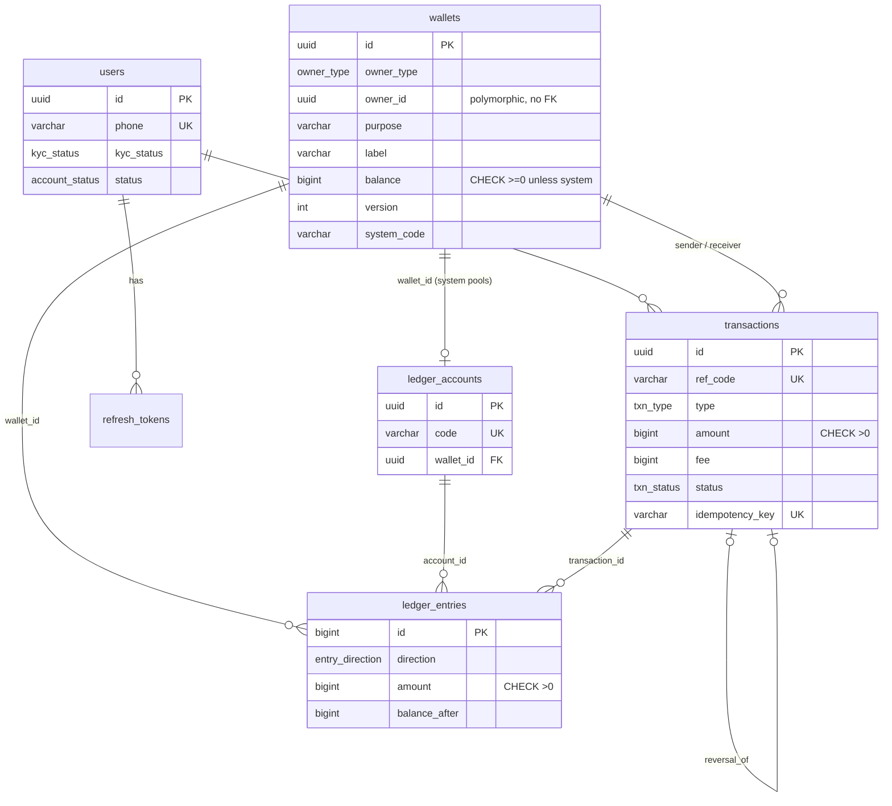

# Data model

Final PostgreSQL schema after applying migrations 000001 to 000013 in order. PostgreSQL 16. All money is `BIGINT` minor units (VND, no decimals). Migrations are written with `IF NOT EXISTS` / `DROP TYPE IF EXISTS ... CASCADE` for enums (see note under Enums).

Migration index: 01 users/admin/auth, 02 wallets+ledger+system seed, 03 services/workflow/outbox, 04 offers/fees/money requests, 05 org/approval/KYC/fraud/recon/AI, 06 user_offers + service dispatch columns + forward-fixes, 07 ledger append-only trigger, 08 vault wallets, 09 round-up + workflow p2p_transfer v2, 10 action pipeline workflows (p2p_transfer v3, org_disbursement v2), 11 `approval_status` + `cancelled`, 12 drop FK on `approval_policies.created_by`, 13 unique policy version.

## Enums

| Enum | Values | Added in |
|---|---|---|
| `account_status` | active, locked, closed | 01 |
| `kyc_status` | none, pending, manual_review, auto_approved, verified, rejected | 01 |
| `admin_role` | viewer, kyc_reviewer, risk_officer, ops, superadmin | 01 |
| `wallet_status` | active, locked, closed | 02 |
| `txn_type` | topup, p2p, disbursement, org_disbursement, reversal, vault_move | 02 |
| `txn_status` | created, pending_approval, processing, processing_async, completed, failed, reversed | 02 |
| `entry_direction` | debit, credit | 02 |
| `owner_type` | user, organization, system | 02 |
| `service_status` | active, maintenance, disabled | 03 |
| `wf_status` | running, waiting_approval, compensating, completed, failed, compensated, recovering, compensation_failed (000022) | 03 |
| `step_status` | completed, failed | 03 |
| `offer_role` | customer, agent, merchant, biller, operator | 04 |
| `auth_method_enum` | none, pin, otp, 2fa | 04 |
| `money_request_status` | pending, paid, declined, expired, canceled | 04 |
| `org_role` | admin, maker, checker | 05 |
| `flag_status` | open, cleared, confirmed_fraud | 05 |
| `recon_result` | matched, amount_mismatch, missing_internal, missing_external | 05 |
| `approval_subject` | org_transaction, reversal | 05 |
| `approval_status` | pending, approved, rejected, expired, cancelled | 05, `cancelled` in 11 |
| `approval_decision` | approve, reject | 05 |

Notes: `money_request_status` uses the American spelling `canceled`; `approval_status` uses `cancelled`. Migrations 01 to 05 start with `DROP TYPE IF EXISTS ... CASCADE`, so re-running them on a populated database drops dependent columns; they are intended for a fresh database only.

## Identity

### users
| Column | Type | Null | Default |
|---|---|---|---|
| id | UUID | no | gen_random_uuid() (PK) |
| phone | VARCHAR(20) | no | UNIQUE |
| email | VARCHAR(160) | yes | UNIQUE |
| full_name | VARCHAR(120) | no | |
| password_hash | TEXT | no | |
| pin_hash | TEXT | yes | |
| kyc_status | kyc_status | no | 'none' |
| status | account_status | no | 'active' |
| created_at, updated_at | TIMESTAMPTZ | no | now() |

Seed: system user `00000000-0000-0000-0000-000000000000`, phone `0000000000`, password_hash `disabled`.

### refresh_tokens
id UUID PK; user_id UUID NOT NULL FK users ON DELETE CASCADE; family_id UUID NOT NULL; token_hash TEXT NOT NULL UNIQUE; device_id VARCHAR(80) NOT NULL; expires_at TIMESTAMPTZ NOT NULL; used_at, revoked_at TIMESTAMPTZ NULL; created_at. Indexes: `idx_refresh_user(user_id)`, `idx_refresh_family(family_id)`.

### otp_challenges
id UUID PK; user_id FK users CASCADE; code_hash TEXT NOT NULL; purpose VARCHAR(40) NOT NULL default 'transfer'; attempts INT default 0; max_attempts INT default 5; expires_at NOT NULL; consumed_at NULL; created_at. No secondary index; no cleanup job.

### admin_users
id UUID PK; email VARCHAR(160) NOT NULL UNIQUE; password_hash TEXT; full_name VARCHAR(120); role admin_role default 'viewer'; status account_status default 'active'; created_at. Seed: `admin@HPay.dev` superadmin (argon2id hash, dev only).

## Wallets and ledger

### wallets
| Column | Type | Null | Default |
|---|---|---|---|
| id | UUID | no | gen_random_uuid() PK |
| owner_type | owner_type | no | |
| owner_id | UUID | no | (no FK, polymorphic: users / organizations / system user) |
| currency | VARCHAR(3) | no | 'VND' |
| purpose | VARCHAR(20) | no | 'main' (also 'vault', system_cash, system_fee, system_suspense) |
| label | VARCHAR(60) | yes | |
| balance | BIGINT | no | 0 |
| status | wallet_status | no | 'active' |
| version | INT | no | 1 (optimistic lock) |
| system_code | VARCHAR(40) | yes | |
| created_at, updated_at | TIMESTAMPTZ | no | now() |
| target_amount | BIGINT | yes | (08, display-only savings goal) |
| round_up_target | BOOLEAN | no | false (09) |

Constraints: `wallet_owner_unique UNIQUE (owner_type, owner_id, currency, purpose, label)` (08); `wallet_balance_non_negative CHECK (balance >= 0 OR owner_type='system')`; `wallet_vault_needs_label CHECK (purpose <> 'vault' OR label IS NOT NULL)`.
Indexes: `idx_wallet_one_main_per_owner UNIQUE (owner_type, owner_id, currency) WHERE purpose='main'`; `idx_wallet_round_up_target_unique UNIQUE (owner_type, owner_id, currency) WHERE round_up_target AND purpose='vault'`.
Seed system wallets (owner = system user, balance 0): `...0001` SYSTEM_CASH_IN (purpose system_cash), `...0002` SYSTEM_FEE (system_fee), `...0003` SYSTEM_SUSPENSE (system_suspense).

### ledger_accounts
id UUID PK; code VARCHAR(40) UNIQUE NOT NULL; name VARCHAR(100); type VARCHAR(20) (asset/income/liability); wallet_id UUID FK wallets (nullable); created_at. Seed: SYS_CASH, SYS_FEE, SYS_SUSPENSE (ids `...0001..0003`, each linked to the same-numbered system wallet). Note `ledger_accounts.code` (SYS_*) differs from `wallets.system_code` (SYSTEM_*).

### ledger_entries (append-only)
id BIGINT identity PK; transaction_id UUID NOT NULL FK transactions; wallet_id UUID NULL FK wallets; account_id UUID NULL FK ledger_accounts; direction entry_direction NOT NULL; amount BIGINT NOT NULL CHECK (amount > 0); balance_after BIGINT NOT NULL (no CHECK, system pools go negative); created_at.
Indexes: `idx_ledger_account(account_id, created_at DESC)`, `idx_ledger_wallet(wallet_id, created_at DESC)`, `idx_ledger_txn(transaction_id)`.
Triggers (07): `trg_ledger_entries_no_update` BEFORE UPDATE and `trg_ledger_entries_no_delete` BEFORE DELETE, FOR EACH ROW, function `ledger_entries_append_only()` raises an exception. TRUNCATE is not blocked.

## Transactions

### transactions
| Column | Type | Null | Default / constraint |
|---|---|---|---|
| id | UUID | no | PK |
| ref_code | VARCHAR(24) | no | UNIQUE |
| type | txn_type | no | |
| sender_wallet_id, receiver_wallet_id | UUID | yes | FK wallets |
| amount | BIGINT | no | CHECK (amount > 0) |
| fee | BIGINT | no | 0, CHECK (fee >= 0) |
| status | txn_status | no | 'created' |
| initiated_by | UUID | no | FK users |
| idempotency_key | VARCHAR(80) | yes | `UNIQUE (initiated_by, idempotency_key)` `uq_txn_user_idempotency` (000015; was globally UNIQUE until 000014). NULL keys are unconstrained |
| request_hash | VARCHAR(64) | yes | SHA-256 hex of the canonical request (000015). NULL = row older than 000015, replay accepted |
| failure_reason | TEXT | yes | |
| note | VARCHAR(255) | yes | |
| reversal_of | UUID | yes | FK transactions |
| completed_at | TIMESTAMPTZ | yes | |
| started_at | TIMESTAMPTZ | yes | when the transaction started to move money (BUG-0018, migration 000027); NULL while awaiting_auth and for older rows; limits read COALESCE(started_at, created_at) |
| created_at | TIMESTAMPTZ | no | now() |

Indexes: `idx_txn_sender(sender_wallet_id, created_at DESC)`, `idx_txn_receiver(receiver_wallet_id, created_at DESC)`, `idx_txn_ref(ref_code)` (redundant with the UNIQUE).

## Workflow

- **workflow_definitions**: id UUID PK; name VARCHAR(60); version INT; steps JSONB NOT NULL; is_active BOOLEAN default true; `wf_def_unique UNIQUE (name, version)`.
  Seeded: `p2p_transfer` v1 (inactive after 09), v2 (inactive after 10), v3 active (VALIDATE, FRAUD_CHECK, ACTIONS_BEFORE_GL, MOVE_FUNDS, ACTIONS_AFTER_GL, CONFIRM, ROUND_UP); `org_disbursement` v1 (inactive), v2 active (VALIDATE, FRAUD_CHECK, ACTIONS_BEFORE_GL, WAIT_APPROVAL, MOVE_FUNDS, CONFIRM); `kyc_verification` v1 (SCORE, CLASSIFY).
- **workflow_instances**: id UUID PK; definition_id FK workflow_definitions NOT NULL; transaction_id FK transactions NULL; status wf_status default 'running'; current_step VARCHAR(40); context JSONB default '{}'; created_at, updated_at. Index `idx_wf_status(status)`.
- **step_executions**: id BIGINT identity PK; instance_id FK workflow_instances; step_name VARCHAR(40); attempt SMALLINT default 1; status step_status NOT NULL; input, output JSONB; error TEXT; started_at default now(); finished_at. `idx_step_exec UNIQUE (instance_id, step_name, attempt)` (the idempotency arbiter).

## Offers and services

- **services**: id UUID PK; code VARCHAR(50) UNIQUE; name VARCHAR(100); full_name VARCHAR(150) NULL; service_note TEXT NULL; category VARCHAR(50); status service_status 'active'; transaction_type VARCHAR(50) 'Normal Transaction'; action_priority VARCHAR(20) 'before_gl'; confirmation BOOLEAN true; service_target VARCHAR(100) NULL; channels JSONB '["Mobile"]'; amount_formula JSONB '{}'; actions JSONB '[]'; input_fields JSONB '[]'; created_at; (06) workflow_name VARCHAR(60) 'p2p_transfer'; ledger_txn_type txn_type 'p2p'; wallet_strategy VARCHAR(30) 'user_to_user' (values by convention user_to_user, syscash_to_user, org_to_user, user_to_vault; not CHECKed).
  Seeded services: P2P_TRANSFER, MONEY_REQUEST, TOPUP_BANK (topup/syscash_to_user), ORG_DISBURSEMENT (org_disbursement workflow/org_to_user), VAULT_SAVINGS (vault_move/user_to_vault).
- **offers**: id UUID PK; code VARCHAR(50) UNIQUE; name; role offer_role 'customer'; level INT 1; is_active true; primary_pocket_max BIGINT 50000000; max_bank_accounts INT 2; updated_by VARCHAR(80) 'system'; updated_at; created_at. Seeded: OFFER_CUST_L1, OFFER_CUST_L2, OFFER_BIZ_STARTER, OFFER_BIZ_ENT.
- **offer_services**: id UUID PK; offer_id FK offers CASCADE; service_id FK services CASCADE; is_enabled true; min_amount 0; max_amount_per_txn 100000000; daily_limit 500000000; monthly_limit 2000000000; interval_seconds INT 0; `UNIQUE(offer_id, service_id)`. 06 backfills every active service for L1, L2, BIZ_STARTER.
- **offer_auth_matrix**: id UUID PK; offer_service_id FK offer_services CASCADE; min_amount BIGINT 0; max_amount BIGINT NULL (open ended); auth_method auth_method_enum 'pin'; created_at. Standard tiers: pin 0-2,000,000; otp 2,000,000-50,000,000; 2fa above 50,000,000. Ranges are not checked for overlap.
- **user_offers** (06): user_id UUID PK FK users CASCADE; offer_id FK offers NOT NULL; assigned_by VARCHAR(80) 'system'; assigned_at. Index `idx_user_offers_offer`. Backfill gives every user OFFER_CUST_L2; seed phones 0900000011..14 get OFFER_BIZ_STARTER.
- **fee_policies**: id UUID PK; txn_type txn_type NOT NULL; kyc_status kyc_status NULL (any); fixed_fee BIGINT 0; percent_bp INT 0; min_fee BIGINT 0; max_fee BIGINT NULL; is_active true; version INT 1. Seed: p2p fixed 1000, topup 0, disbursement 0 (note: not `org_disbursement`).
- **money_requests**: id UUID PK; requester_id, payer_id FK users NOT NULL; amount BIGINT CHECK (amount > 0); note VARCHAR(255); split_group_id UUID NULL (no table); status money_request_status 'pending'; paid_txn_id FK transactions NULL; last_reminded_at; expires_at NOT NULL; created_at; `no_self_request CHECK (requester_id <> payer_id)`. Index `idx_money_req_payer(payer_id, status)`. Added by 000015: `idempotency_key VARCHAR(80) NULL`, `request_hash VARCHAR(64) NULL`, partial unique index `uq_money_req_user_idempotency (requester_id, idempotency_key) WHERE idempotency_key IS NOT NULL AND split_group_id IS NULL` (single requests; splits are serialized by an advisory lock).

## Approval and organization

- **organizations**: id UUID PK; code VARCHAR(30) UNIQUE default `'ORG_' || first 12 hex of uuid`; name VARCHAR(120); status account_status 'active'; created_by FK users NULL; created_at.
- **org_members**: id PK; org_id FK organizations CASCADE; user_id FK users CASCADE; role org_role 'maker'; checker_level SMALLINT NULL CHECK (NULL or 1..5); created_at; `member_unique UNIQUE (org_id, user_id)`.
- **approval_policies**: id PK; org_id FK organizations CASCADE NULL; name VARCHAR(80); min_amount BIGINT 0; max_amount BIGINT NULL; tiers JSONB '[]'; version INT 1; is_active true; created_by UUID NULL (no FK since 12); created_at; `approval_policies_org_name_version_key UNIQUE (org_id, name, version)` (13). NULL org_id rows are never considered equal by the unique constraint.
- **approval_policy_tiers**: id PK; policy_id FK approval_policies CASCADE; level INT 1; tier_level INT 1; min_amount BIGINT CHECK >= 0; max_amount BIGINT NULL CHECK (NULL or > min_amount); level1_required, level2_required, level3_required INT 0; created_at. Tiers also live in `approval_policies.tiers` JSONB (duplicate representation).
- **approval_requests**: id PK; subject_type approval_subject; subject_id UUID NULL (no FK, polymorphic); org_id FK NULL; instance_id FK workflow_instances NULL; policy_id FK approval_policies NULL; policy_version INT 1; policy_snapshot JSONB '{}'; status approval_status 'pending'; current_level SMALLINT 1; reason TEXT; final_decision VARCHAR(20); final_decision_at; finalized_at; created_by UUID NULL (no FK: user or admin id); expires_at NOT NULL; created_at.
- **approval_actions**: id BIGINT identity PK; request_id FK approval_requests CASCADE; checker_id UUID NOT NULL (no FK: user or admin); level SMALLINT 1; action approval_decision; reason VARCHAR(255); acted_at; created_at; `one_action_per_checker UNIQUE (request_id, checker_id)`.

## KYC

**kyc_requests**: id PK; user_id FK users; id_card_url TEXT NOT NULL; selfie_url TEXT NOT NULL; ai_score NUMERIC(5,2); ai_verdict VARCHAR(20); ai_reasons JSONB; status kyc_status 'pending'; reviewer_id FK admin_users NULL; reviewed_at; created_at. No index on user_id or status.

## Fraud and reconciliation

- **fraud_flags**: id PK; transaction_id FK transactions NOT NULL; rule_code VARCHAR(40); score NUMERIC(5,2); reasons JSONB '[]'; status flag_status 'open'; reviewer_id FK admin_users NULL; reviewed_at; created_at.
- **bank_statements**: id BIGINT identity PK; ref_code VARCHAR(24); amount BIGINT; stmt_date DATE; raw JSONB '{}'.
- **reconciliation_runs**: id PK; run_date DATE UNIQUE; total, matched, mismatched INT 0; ai_summary TEXT; report_url TEXT; created_at.
- **reconciliation_items**: id BIGINT identity PK; run_id FK reconciliation_runs; transaction_id FK transactions NULL; statement_id FK bank_statements NULL; result recon_result; detail JSONB.

## AI

- **ai_keys**: id PK; provider VARCHAR(40); name VARCHAR(100); key_ciphertext TEXT; api_key TEXT (plaintext, audit finding); key_masked VARCHAR(30) 'sk-****'; is_active true; created_at, updated_at.
- **ai_function_settings**: function_name VARCHAR(60) PK; provider VARCHAR(40); model VARCHAR(80); model_name VARCHAR(80) default 'claude-3-5-sonnet-20241022'; key_id FK ai_keys NULL; api_key VARCHAR(255); updated_at. Seed: `kyc_scoring` and `fraud_advising`, provider 'mock'.

## Outbox

**outbox**: id BIGINT identity PK; aggregate VARCHAR(50) 'system'; event_type VARCHAR(50); payload JSONB; available_at default now(); published_at NULL; created_at. Partial index `idx_outbox_pending(available_at) WHERE published_at IS NULL`. No attempts / last_error / dead-letter columns.

## Audit

**audit_logs**: id BIGINT identity PK; actor_id UUID NOT NULL (no FK); actor_type VARCHAR(20); action VARCHAR(60); resource VARCHAR(120); reason TEXT; before, after JSONB; ip VARCHAR(45); created_at. Indexes `idx_audit_actor(actor_id, created_at DESC)`, `idx_audit_action(action, created_at DESC)`. Not protected by an append-only trigger.

## ER overview (core money tables)

## Constraints that are missing

Guarantees the code relies on or the design states, that the schema does NOT enforce (verified by reading all 13 migrations; cross-checked with docs/audit/AUDIT-REPORT.md, which proposes a migration 000014 that does not exist yet).

| # | Missing guarantee | Current state | Consequence |
|---|---|---|---|
| 1 | ~~Idempotency key unique per user and payload-bound~~ | Fixed by 000015: `UNIQUE (initiated_by, idempotency_key)` + `request_hash` (ADR-0011). Rows older than 000015 have a NULL hash and accept any replay | Org package still compares the key only (follow-up) |
| 2 | Debits equal credits per transaction | Checked only in Go (`ledger.Post`, `ErrUnbalanced`); no constraint trigger | A buggy writer can persist unbalanced entries |
| 3 | No double posting of the same movement | No UNIQUE on `ledger_entries` (e.g. transaction_id + kind); `ledger.Post` does not check | Redelivered MOVE_FUNDS can post twice (BE-C1) |
| 4 | Entry targets a wallet or an account | No CHECK `wallet_id IS NOT NULL OR account_id IS NOT NULL` | Orphan entries possible |
| 5 | `wallets.balance = SUM(ledger_entries)` | Not enforced; verified by recon/seed code only | Drift is detectable (`recon.ErrBalanceDrift`) but not prevented |
| 6 | One reversal per transaction | No UNIQUE on `transactions(reversal_of)`; only the `rev-<id>` idempotency key | Raw 23505 and possibly stuck approval (BE-H3) |
| 7 | One pending approval per subject | No UNIQUE on `approval_requests(subject_type, subject_id)` where pending | Duplicate pending requests possible |
| 8 | Sender differs from receiver | No CHECK on `transactions` (only `ledger.ErrSelfTransfer` in Go) | |
| 9 | Currency integrity | `wallets.currency` has no CHECK; `ledger_entries` has no currency column | Cross-currency posting not blocked |
| 10 | Fee policy sanity and uniqueness | `fee_policies` has no CHECK (percent_bp range, max >= min) and no UNIQUE (txn_type, kyc_status, version) | Overlapping active policies |
| 11 | Service/offer enum-like text | `services.wallet_strategy`, `category`, `transaction_type`, `action_priority`, `ledger_accounts.type`, `audit_logs.actor_type`, `otp_challenges.purpose` are free text without CHECK | Typos silently accepted |
| 12 | Auth matrix ranges do not overlap and cover all amounts | No exclusion constraint | Ambiguous or missing auth method |
| 13 | Wallet owner exists | `wallets.owner_id` polymorphic, no FK | Dangling owners possible |
| 14 | Polymorphic actor ids resolve | `approval_requests.created_by`, `approval_actions.checker_id`, `approval_policies.created_by`, `audit_logs.actor_id` have no FK (dropped in 06 and 12 on purpose) | App layer must disambiguate user vs admin |
| 15 | Money request split group | `money_requests.split_group_id` has no table / FK | |
| 16 | Money request marked paid only after the txn completes | No constraint linking `paid_txn_id` status | Request can stay `paid` after a failed workflow (BE-H5) |
| 17 | Approval policy tiers consistent | Tiers stored both in `approval_policies.tiers` JSONB and `approval_policy_tiers`; no sync | Drift |
| 18 | Ledger immutability fully enforced | Trigger blocks UPDATE/DELETE only; TRUNCATE and DB-role grants are not restricted | |
| 19 | Audit log immutability | No trigger on `audit_logs` | Rows can be edited |
| 20 | Outbox delivery bookkeeping | No attempts/last_error/dead letter; index order (available_at) differs from relay query order (id) | Poison event can block queue |
| 21 | Hot-path query indexes | No index on `transactions(initiated_by, type, created_at)` (OfferGuard/fraud), `kyc_requests(user_id|status)`, `fraud_flags(status)`, `approval_requests(status, org_id)` | Sequential scans |
| 22 | Secrets at rest | `ai_keys.api_key` is plaintext (`key_ciphertext` unused by default) | |
| 23 | Offer limit race | Fixed (BUG-0017): no counter row; the confirm step serializes per user with an advisory lock and re-sums the volume | none known |
| 24 | Platform admin RBAC | `admin_users.role` exists but nothing in the router/DB restricts by role | Any admin can call every `/v1/admin` endpoint |

Verified present (not missing): non-negative balance for non-system wallets, one main wallet per owner, vault needs label, one round-up target per owner, append-only ledger trigger, unique step execution per (instance, step, attempt), one action per checker per request, unique policy version per (org, name), no self money request.

## Added by migration 000014 (ADR-0010)

| Object | Definition |
|--------|------------|
| enum posting_kind | orward, compensate, 
ound_up |
| table ledger_postings | 	ransaction_id UUID NOT NULL REFERENCES transactions(id), kind posting_kind NOT NULL, 	otal_amount BIGINT NOT NULL CHECK (total_amount > 0) (sum of the debit legs), created_at TIMESTAMPTZ NOT NULL DEFAULT now(), PRIMARY KEY (	ransaction_id, kind). One row per posting; claimed by ledger.Post inside the posting transaction. Back-filled with a orward row for every transaction that already had ledger entries. |

In the 'Constraints that are missing' list: the row about nothing preventing a second posting of a transaction is now closed by this table.

## Added by migrations 000016 and 000017 (ADR-0013)

| Object | Definition |
|--------|------------|
| enum value approval_status = 'needs_manual' | request whose approved effect could not be applied; terminal for the decision flow (000016, own file because ALTER TYPE ADD VALUE cannot share a transaction) |
| unique index one_reversal_per_txn | on 	ransactions (reversal_of) WHERE reversal_of IS NOT NULL (000017; the migration fails with the offending ids if duplicates exist) |
| unique index one_pending_approval_per_subject | on approval_requests (subject_type, subject_id) WHERE status = 'pending' (000017) |

Both rows in 'Constraints that are missing' about reversal uniqueness are now closed.

## Added by migrations 000018 to 000021 (ADR-0014)

| Object | Definition |
|--------|------------|
| users.pin_failed_attempts INT NOT NULL DEFAULT 0 CHECK (>= 0), users.pin_locked_until TIMESTAMPTZ | PIN attempt counter and lockout (000018). users.pin_hash already existed and is now used |
| users.login_failed_attempts INT NOT NULL DEFAULT 0 CHECK (>= 0), users.login_locked_until TIMESTAMPTZ; the same two columns on admin_users | Login failure counter and 15-minute lockout (000024, BUG-0016). |
| users.pin_reset_at TIMESTAMPTZ | Start of the 24 hour cooling period after a PIN reset or operator clear (000025, ADR-0016). |
| user_totp(user_id PK, secret_enc BYTEA, enabled, last_step BIGINT, failed_attempts, locked_until, created_at, activated_at) | TOTP authenticator per user (000026, ADR-0017). `secret_enc` is the AES-256-GCM ciphertext of the shared secret; `last_step` makes a code single-use. |
| user_recovery_codes(id, user_id, code_hash, used_at, created_at; UNIQUE(user_id, code_hash)) | Ten single-use recovery codes per enrolment, stored only as SHA-256 hashes (000026). |
| enum value 	xn_status = 'awaiting_auth' | request held until the credential is verified (000019, own file) |
| 	ransactions.auth_method auth_method_enum | the method the request required, checked at confirm (000020) |
| 	ransactions.workflow_name VARCHAR(60), 	ransactions.service_code VARCHAR(40) | what the request resolved, so confirm starts exactly that workflow (000021); NULL for old rows and for requests that needed no confirmation |
